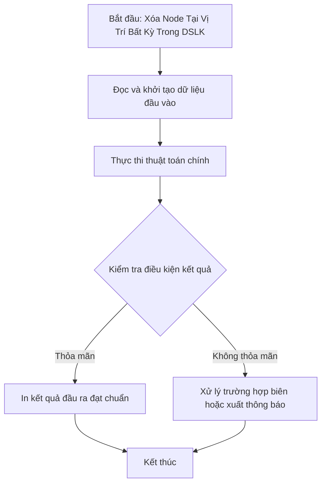

# Xóa Node Tại Vị Trí Bất Kỳ Trong DSLK

## 1. Thông tin tệp mã nguồn
- [`Xoa_node_giua.cpp`](./Xoa_node_giua.cpp)
- **Thư mục chuyên đề**: `DSA/06_Danh_Sach_Lien_Ket/Xoa_node_giua/`
- **Ngôn ngữ**: C/C++ (Chuẩn C++11 trở lên)

## 2. Mục tiêu & Tóm tắt bài toán
Xóa node tại vị trí thứ K trong danh sách liên kết.

---

## 3. Ý tưởng & Phương pháp giải thuật
### Phương án tiếp cận:
Duyệt tới node K-1, bỏ qua node K và nối tới node K+1.

### Các bước thực hiện chi tiết:
1. Khởi tạo dữ liệu và đọc đầu vào theo định dạng bài toán.
2. Thực hiện thuật toán cốt lõi: Duyệt tới node K-1, bỏ qua node K và nối tới node K+1.
3. Cập nhật trạng thái và tính toán kết quả.
4. Xuất kết quả đầu ra màn hình.

---

## 4. Sơ đồ thuật toán (Mermaid Workflow)


---

## 5. Đánh giá độ phức tạp
- **Độ phức tạp thời gian (Time Complexity)**: `O(N)`
- **Độ phức tạp không gian (Space Complexity)**: `O(1)`

---

## 6. Input / Output mẫu & Giải thích

### Input mẫu:
```text
4 2
1 2 3 4
```

### Output mẫu:
```text
Nhap vi tri can xoa:5 4 3 1
```

### Giải thích:
Xóa node tại vị trí 2.

## 7. Hướng dẫn biên dịch & chạy thử
```bash
# Di chuyển vào thư mục bài toán
cd "DSA/06_Danh_Sach_Lien_Ket/Xoa_node_giua"

# Biên dịch chương trình C++
g++ -std=c++11 -O2 "Xoa_node_giua.cpp" -o "Xoa_node_giua"

# Chạy chương trình
./"Xoa_node_giua"
```

> [!NOTE]
> Toàn bộ mã nguồn C++ gốc được bảo toàn nguyên vẹn 100% không qua chỉnh sửa.
