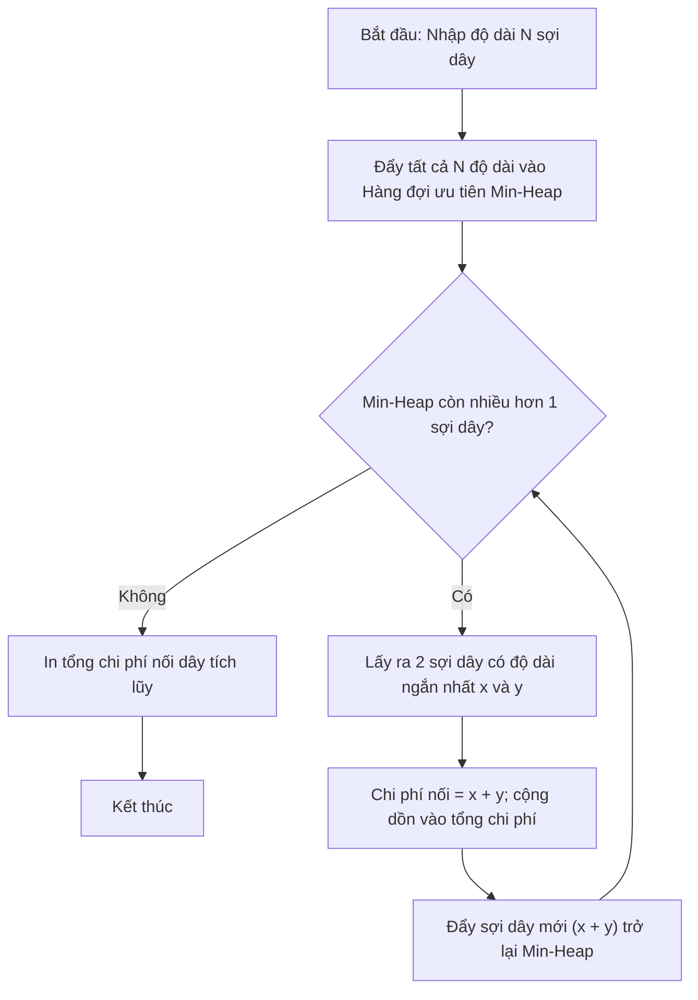

# Bài Toán Nối Dây (Huffman / Priority Queue)

## 1. Thông tin tệp mã nguồn
- [`Bai_toan_noi_day.cpp`](./Bai_toan_noi_day.cpp)
- **Thư mục chuyên đề**: `DSA/07_Ngan_Xep_va_Hang_Doi/Bai_toan_noi_day/`
- **Ngôn ngữ**: C/C++ (Chuẩn C++11 trở lên)

## 2. Mục tiêu & Tóm tắt bài toán
Nối N sợi dây với tổng chi phí nhỏ nhất.

---

## 3. Ý tưởng & Phương pháp giải thuật
### Phương án tiếp cận:
Hàng đợi ưu tiên Min-Heap liên tục lấy 2 sợi ngắn nhất nối lại.

### Các bước thực hiện chi tiết:
1. Khởi tạo dữ liệu và đọc đầu vào theo định dạng bài toán.
2. Thực hiện thuật toán cốt lõi: Hàng đợi ưu tiên Min-Heap liên tục lấy 2 sợi ngắn nhất nối lại.
3. Cập nhật trạng thái và tính toán kết quả.
4. Xuất kết quả đầu ra màn hình.

---

## 4. Sơ đồ thuật toán (Mermaid Workflow)


---

## 5. Đánh giá độ phức tạp
- **Độ phức tạp thời gian (Time Complexity)**: `O(N log N)`
- **Độ phức tạp không gian (Space Complexity)**: `O(N)`

---

## 6. Input / Output mẫu & Giải thích

### Input mẫu:
```text
4
4 3 2 6
```

### Output mẫu:
```text
283
1119
1119
1119
```

### Giải thích:
Chi phí nối dây cực tiểu.

## 7. Hướng dẫn biên dịch & chạy thử
```bash
# Di chuyển vào thư mục bài toán
cd "DSA/07_Ngan_Xep_va_Hang_Doi/Bai_toan_noi_day"

# Biên dịch chương trình C++
g++ -std=c++11 -O2 "Bai_toan_noi_day.cpp" -o "Bai_toan_noi_day"

# Chạy chương trình
./"Bai_toan_noi_day"
```

> [!NOTE]
> Toàn bộ mã nguồn C++ gốc được bảo toàn nguyên vẹn 100% không qua chỉnh sửa.
