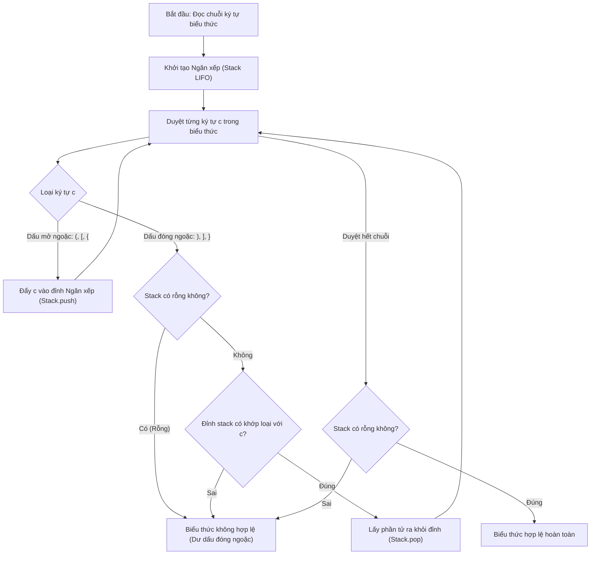

# Kiểm Tra Dấu Ngoặc Hợp Lệ (LeetCode 20)

## 1. Thông tin tệp mã nguồn
- [`Dau_ngoac_hop_le.cpp`](./Dau_ngoac_hop_le.cpp)
- **Thư mục chuyên đề**: `DSA/07_Ngan_Xep_va_Hang_Doi/Dau_ngoac_hop_le/`
- **Ngôn ngữ**: C/C++ (Chuẩn C++11 trở lên)

## 2. Mục tiêu & Tóm tắt bài toán
Kiểm tra chuỗi ngoặc (), [], {} đóng mở đúng quy tắc.

---

## 3. Ý tưởng & Phương pháp giải thuật
### Phương án tiếp cận:
Dùng Stack lưu dấu mở ngoặc, kiểm tra khớp khi gặp dấu đóng.

### Các bước thực hiện chi tiết:
1. Khởi tạo dữ liệu và đọc đầu vào theo định dạng bài toán.
2. Thực hiện thuật toán cốt lõi: Dùng Stack lưu dấu mở ngoặc, kiểm tra khớp khi gặp dấu đóng.
3. Cập nhật trạng thái và tính toán kết quả.
4. Xuất kết quả đầu ra màn hình.

---

## 4. Sơ đồ thuật toán (Mermaid Workflow)


---

## 5. Đánh giá độ phức tạp
- **Độ phức tạp thời gian (Time Complexity)**: `O(N)`
- **Độ phức tạp không gian (Space Complexity)**: `O(N)`

---

## 6. Input / Output mẫu & Giải thích

### Input mẫu:
```text
{[()]}
```

### Output mẫu:
```text
True
```

### Giải thích:
Dấu ngoặc hợp lệ.

## 7. Hướng dẫn biên dịch & chạy thử
```bash
# Di chuyển vào thư mục bài toán
cd "DSA/07_Ngan_Xep_va_Hang_Doi/Dau_ngoac_hop_le"

# Biên dịch chương trình C++
g++ -std=c++11 -O2 "Dau_ngoac_hop_le.cpp" -o "Dau_ngoac_hop_le"

# Chạy chương trình
./"Dau_ngoac_hop_le"
```

> [!NOTE]
> Toàn bộ mã nguồn C++ gốc được bảo toàn nguyên vẹn 100% không qua chỉnh sửa.
