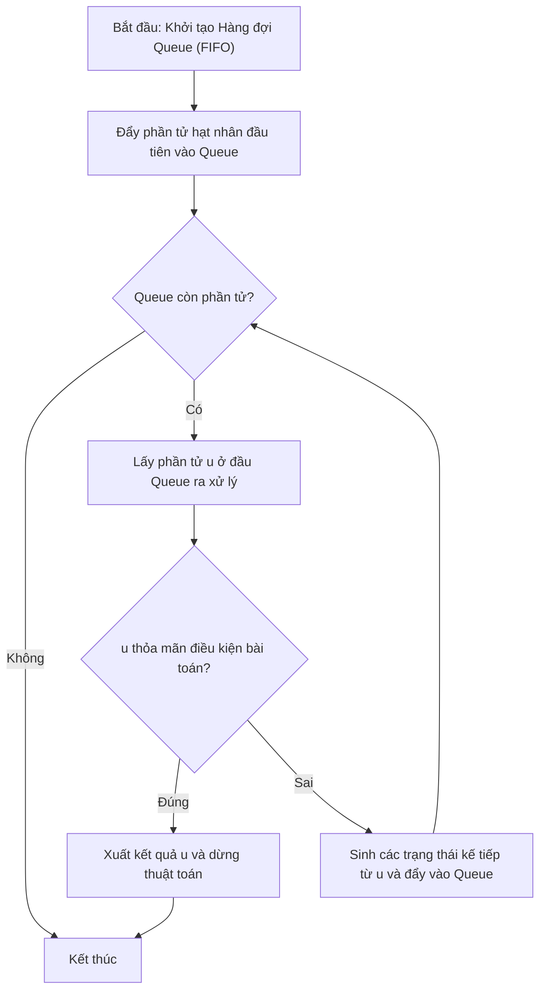

# Bội Số Của 0 và 9 (Queue)

## 1. Thông tin tệp mã nguồn
- [`boiso0,9.cpp`](./boiso0,9.cpp)
- **Thư mục chuyên đề**: `DSA/07_Ngan_Xep_va_Hang_Doi/boiso0,9/`
- **Ngôn ngữ**: C/C++ (Chuẩn C++11 trở lên)

## 2. Mục tiêu & Tóm tắt bài toán
Tìm số nhỏ nhất chỉ chứa 0 và 9 chia hết cho N.

---

## 3. Ý tưởng & Phương pháp giải thuật
### Phương án tiếp cận:
Hàng đợi sinh các số 0, 9 theo BFS.

### Các bước thực hiện chi tiết:
1. Khởi tạo dữ liệu và đọc đầu vào theo định dạng bài toán.
2. Thực hiện thuật toán cốt lõi: Hàng đợi sinh các số 0, 9 theo BFS.
3. Cập nhật trạng thái và tính toán kết quả.
4. Xuất kết quả đầu ra màn hình.

---

## 4. Sơ đồ thuật toán (Mermaid Workflow)


---

## 5. Đánh giá độ phức tạp
- **Độ phức tạp thời gian (Time Complexity)**: `O(N)`
- **Độ phức tạp không gian (Space Complexity)**: `O(N)`

---

## 6. Input / Output mẫu & Giải thích

### Input mẫu:
```text
5
```

### Output mẫu:
```text
90
```

### Giải thích:
Số 90 là bội số nhỏ nhất chỉ tạo bởi các chữ số 0 và 9 chia hết cho 5.

## 7. Hướng dẫn biên dịch & chạy thử
```bash
# Di chuyển vào thư mục bài toán
cd "DSA/07_Ngan_Xep_va_Hang_Doi/boiso0,9"

# Biên dịch chương trình C++
g++ -std=c++11 -O2 "boiso0,9.cpp" -o "boiso0,9"

# Chạy chương trình
./"boiso0,9"
```

> [!NOTE]
> Toàn bộ mã nguồn C++ gốc được bảo toàn nguyên vẹn 100% không qua chỉnh sửa.
