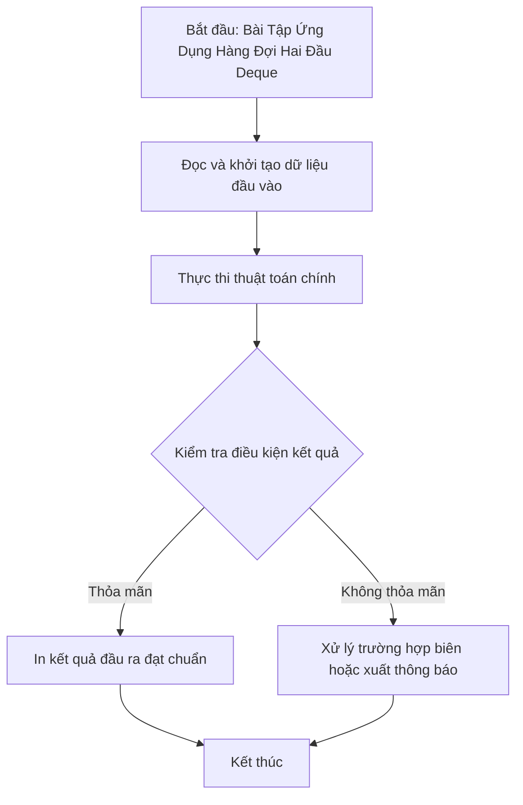

# Bài Tập Ứng Dụng Hàng Đợi Hai Đầu Deque

## 1. Thông tin tệp mã nguồn
- [`bt deque.cpp`](./bt deque.cpp)
- **Thư mục chuyên đề**: `DSA/07_Ngan_Xep_va_Hang_Doi/bt deque/`
- **Ngôn ngữ**: C/C++ (Chuẩn C++11 trở lên)

## 2. Mục tiêu & Tóm tắt bài toán
Thực hành các thao tác push_front, push_back, pop_front, pop_back.

---

## 3. Ý tưởng & Phương pháp giải thuật
### Phương án tiếp cận:
Sử dụng std::deque hai đầu.

### Các bước thực hiện chi tiết:
1. Khởi tạo dữ liệu và đọc đầu vào theo định dạng bài toán.
2. Thực hiện thuật toán cốt lõi: Sử dụng std::deque hai đầu.
3. Cập nhật trạng thái và tính toán kết quả.
4. Xuất kết quả đầu ra màn hình.

---

## 4. Sơ đồ thuật toán (Mermaid Workflow)


---

## 5. Đánh giá độ phức tạp
- **Độ phức tạp thời gian (Time Complexity)**: `O(1) mỗi thao tác`
- **Độ phức tạp không gian (Space Complexity)**: `O(N)`

---

## 6. Input / Output mẫu & Giải thích

### Input mẫu:
```text
Không yêu cầu tham số đầu vào (dữ liệu được khởi tạo trực tiếp trong mã nguồn)
```

### Output mẫu:
```text
2
5
3
0
2 4 5
```

### Giải thích:
Chương trình thực thi và xuất kết quả trực tiếp từ dữ liệu mẫu trong mã nguồn.

## 7. Hướng dẫn biên dịch & chạy thử
```bash
# Di chuyển vào thư mục bài toán
cd "DSA/07_Ngan_Xep_va_Hang_Doi/bt deque"

# Biên dịch chương trình C++
g++ -std=c++11 -O2 "bt deque.cpp" -o "bt deque"

# Chạy chương trình
./"bt deque"
```

> [!NOTE]
> Toàn bộ mã nguồn C++ gốc được bảo toàn nguyên vẹn 100% không qua chỉnh sửa.
