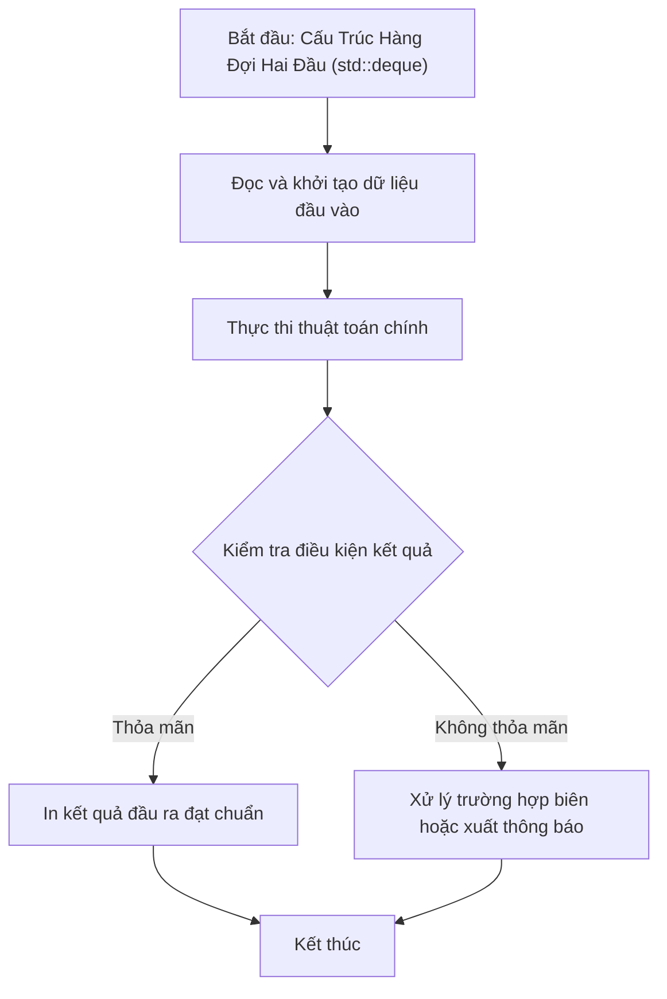

# Cấu Trúc Hàng Đợi Hai Đầu (std::deque)

## 1. Thông tin tệp mã nguồn
- [`deque.cpp`](./deque.cpp)
- **Thư mục chuyên đề**: `DSA/07_Ngan_Xep_va_Hang_Doi/deque/`
- **Ngôn ngữ**: C/C++ (Chuẩn C++11 trở lên)

## 2. Mục tiêu & Tóm tắt bài toán
Minh họa các thao tác cơ bản trên Hàng đợi hai đầu (std::deque).

---

## 3. Ý tưởng & Phương pháp giải thuật
### Phương án tiếp cận:
Thực hiện đẩy phần tử vào đầu (push_front), vào cuối (push_back), truy xuất front, back, size, empty và duyệt iterator.

### Các bước thực hiện chi tiết:
1. Khởi tạo dữ liệu và đọc đầu vào theo định dạng bài toán.
2. Thực hiện thuật toán cốt lõi: Thao tác truy xuất hai đầu nhanh chóng.
3. Cập nhật trạng thái và tính toán kết quả.
4. Xuất kết quả đầu ra màn hình.

---

## 4. Sơ đồ thuật toán (Mermaid Workflow)


---

## 5. Đánh giá độ phức tạp
- **Độ phức tạp thời gian (Time Complexity)**: `O(1)`
- **Độ phức tạp không gian (Space Complexity)**: `O(N)`

---

## 6. Input / Output mẫu & Giải thích

### Input mẫu:
```text
Không yêu cầu tham số đầu vào (dữ liệu thao tác trực tiếp trong main)
```

### Output mẫu:
```text
2
5
3
0
2 4 5
```

### Giải thích:
Đẩy 2 vào đầu, 4 và 5 vào cuối -> deque {2, 4, 5}. front=2, back=5, size=3, empty=0 (không rỗng), duyệt in ra 2 4 5.

## 7. Hướng dẫn biên dịch & chạy thử
```bash
# Di chuyển vào thư mục bài toán
cd "DSA/07_Ngan_Xep_va_Hang_Doi/deque"

# Biên dịch chương trình C++
g++ -std=c++11 -O2 "deque.cpp" -o "deque"

# Chạy chương trình
./"deque"
```

> [!NOTE]
> Toàn bộ mã nguồn C++ gốc được bảo toàn nguyên vẹn 100% không qua chỉnh sửa.
