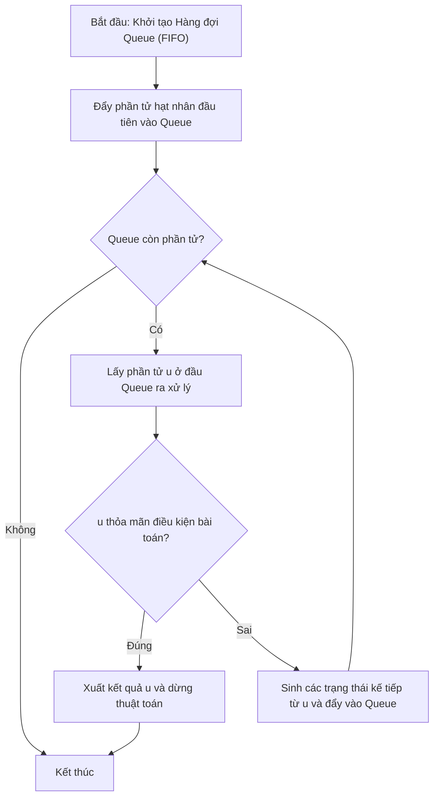

# Sinh Số Nhị Phân Bằng Hàng Đợi

## 1. Thông tin tệp mã nguồn
- [`hangdoi_nhiphan.cpp`](./hangdoi_nhiphan.cpp)
- **Thư mục chuyên đề**: `DSA/07_Ngan_Xep_va_Hang_Doi/hangdoi_nhiphan/`
- **Ngôn ngữ**: C/C++ (Chuẩn C++11 trở lên)

## 2. Mục tiêu & Tóm tắt bài toán
Liệt kê các số nhị phân từ 1 đến N bằng Queue.

---

## 3. Ý tưởng & Phương pháp giải thuật
### Phương án tiếp cận:
Đẩy '1' vào queue, mỗi lần lấy ra in và đẩy s+'0', s+'1'.

### Các bước thực hiện chi tiết:
1. Khởi tạo dữ liệu và đọc đầu vào theo định dạng bài toán.
2. Thực hiện thuật toán cốt lõi: Đẩy '1' vào queue, mỗi lần lấy ra in và đẩy s+'0', s+'1'.
3. Cập nhật trạng thái và tính toán kết quả.
4. Xuất kết quả đầu ra màn hình.

---

## 4. Sơ đồ thuật toán (Mermaid Workflow)


---

## 5. Đánh giá độ phức tạp
- **Độ phức tạp thời gian (Time Complexity)**: `O(N)`
- **Độ phức tạp không gian (Space Complexity)**: `O(N)`

---

## 6. Input / Output mẫu & Giải thích

### Input mẫu:
```text
5
```

### Output mẫu:
```text
1 
1 
1 
1 
1
```

### Giải thích:
Sinh nhị phân bằng Queue.

## 7. Hướng dẫn biên dịch & chạy thử
```bash
# Di chuyển vào thư mục bài toán
cd "DSA/07_Ngan_Xep_va_Hang_Doi/hangdoi_nhiphan"

# Biên dịch chương trình C++
g++ -std=c++11 -O2 "hangdoi_nhiphan.cpp" -o "hangdoi_nhiphan"

# Chạy chương trình
./"hangdoi_nhiphan"
```

> [!NOTE]
> Toàn bộ mã nguồn C++ gốc được bảo toàn nguyên vẹn 100% không qua chỉnh sửa.
