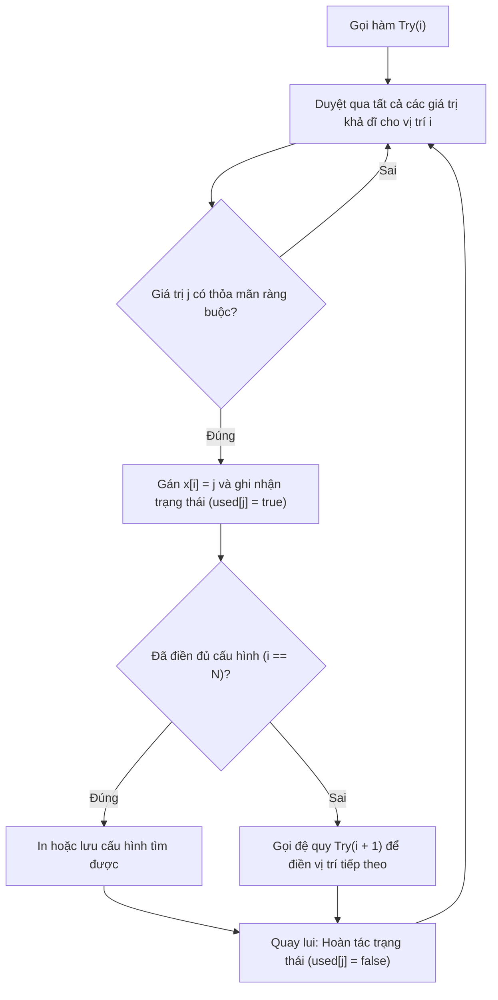

# Quay Lui Tổ Hợp Chập K Của N

## 1. Thông tin tệp mã nguồn
- [`ToHopChapKCuaN.cpp`](./ToHopChapKCuaN.cpp)
- **Thư mục chuyên đề**: `DSA/08_Quay_Lui_va_Nhanh_Can/ToHopChapKCuaN/`
- **Ngôn ngữ**: C/C++ (Chuẩn C++11 trở lên)

## 2. Mục tiêu & Tóm tắt bài toán
Liệt kê C(N, K) tổ hợp chập K của N phần tử.

---

## 3. Ý tưởng & Phương pháp giải thuật
### Phương án tiếp cận:
Giá trị tại bước i chạy từ x[i-1]+1 đến n-k+i.

### Các bước thực hiện chi tiết:
1. Khởi tạo dữ liệu và đọc đầu vào theo định dạng bài toán.
2. Thực hiện thuật toán cốt lõi: Giá trị tại bước i chạy từ x[i-1]+1 đến n-k+i.
3. Cập nhật trạng thái và tính toán kết quả.
4. Xuất kết quả đầu ra màn hình.

---

## 4. Sơ đồ thuật toán (Mermaid Workflow)


---

## 5. Đánh giá độ phức tạp
- **Độ phức tạp thời gian (Time Complexity)**: `O(C(N, K))`
- **Độ phức tạp không gian (Space Complexity)**: `O(K)`

---

## 6. Input / Output mẫu & Giải thích

### Input mẫu:
```text
max i:n-k+1
min i:x[i-1]+1
Duyet cac kha nang ma x[i] co the nhan duoc
So cau hinh cua to hop chap k cua n
```

### Output mẫu:
```text
123456789101112131415161718192021222324252627282930313233343536373839404142434445464748495051525354555657585960616263646566676869707172737475767778798081828384858687888990919293949596979899100
```

### Giải thích:
Liệt kê tổ hợp.

## 7. Hướng dẫn biên dịch & chạy thử
```bash
# Di chuyển vào thư mục bài toán
cd "DSA/08_Quay_Lui_va_Nhanh_Can/ToHopChapKCuaN"

# Biên dịch chương trình C++
g++ -std=c++11 -O2 "ToHopChapKCuaN.cpp" -o "ToHopChapKCuaN"

# Chạy chương trình
./"ToHopChapKCuaN"
```

> [!NOTE]
> Toàn bộ mã nguồn C++ gốc được bảo toàn nguyên vẹn 100% không qua chỉnh sửa.
