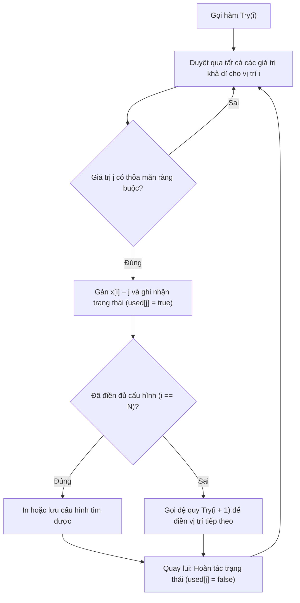

# Bài Toán Tổng Kết Hợp (Combination Sum - LeetCode 39)

## 1. Thông tin tệp mã nguồn
- [`Tong_ket_hop.cpp`](./Tong_ket_hop.cpp)
- **Thư mục chuyên đề**: `DSA/08_Quay_Lui_va_Nhanh_Can/Tong_ket_hop/`
- **Ngôn ngữ**: C/C++ (Chuẩn C++11 trở lên)

## 2. Mục tiêu & Tóm tắt bài toán
Bài toán Tổng kết hợp (Combination Sum) trên LeetCode.

---

## 3. Ý tưởng & Phương pháp giải thuật
### Phương án tiếp cận:
Đệ quy quay lui (Backtracking) để tìm tất cả các tổ hợp số có tổng bằng giá trị mục tiêu target.

### Các bước thực hiện chi tiết:
1. Khởi tạo dữ liệu và đọc đầu vào theo định dạng bài toán.
2. Thực hiện thuật toán cốt lõi: Quay lui vét cạn nhánh cận trừ dần target.
3. Cập nhật trạng thái và tính toán kết quả.
4. Xuất kết quả đầu ra màn hình.

---

## 4. Sơ đồ thuật toán (Mermaid Workflow)


---

## 5. Đánh giá độ phức tạp
- **Độ phức tạp thời gian (Time Complexity)**: `O(2^target)`
- **Độ phức tạp không gian (Space Complexity)**: `O(target)`

---

## 6. Input / Output mẫu & Giải thích

### Input mẫu:
```text
candidates = [2, 3, 6, 7], target = 7
```

### Output mẫu:
```text
[
  [2, 2, 3],
  [7]
]
```

### Giải thích:
2 + 2 + 3 = 7 và 7 = 7 là 2 tổ hợp duy nhất tạo thành tổng 7.

## 7. Hướng dẫn biên dịch & chạy thử
```bash
# Di chuyển vào thư mục bài toán
cd "DSA/08_Quay_Lui_va_Nhanh_Can/Tong_ket_hop"

# Biên dịch chương trình C++
g++ -std=c++11 -O2 "Tong_ket_hop.cpp" -o "Tong_ket_hop"

# Chạy chương trình
./"Tong_ket_hop"
```

> [!NOTE]
> Toàn bộ mã nguồn C++ gốc được bảo toàn nguyên vẹn 100% không qua chỉnh sửa.
