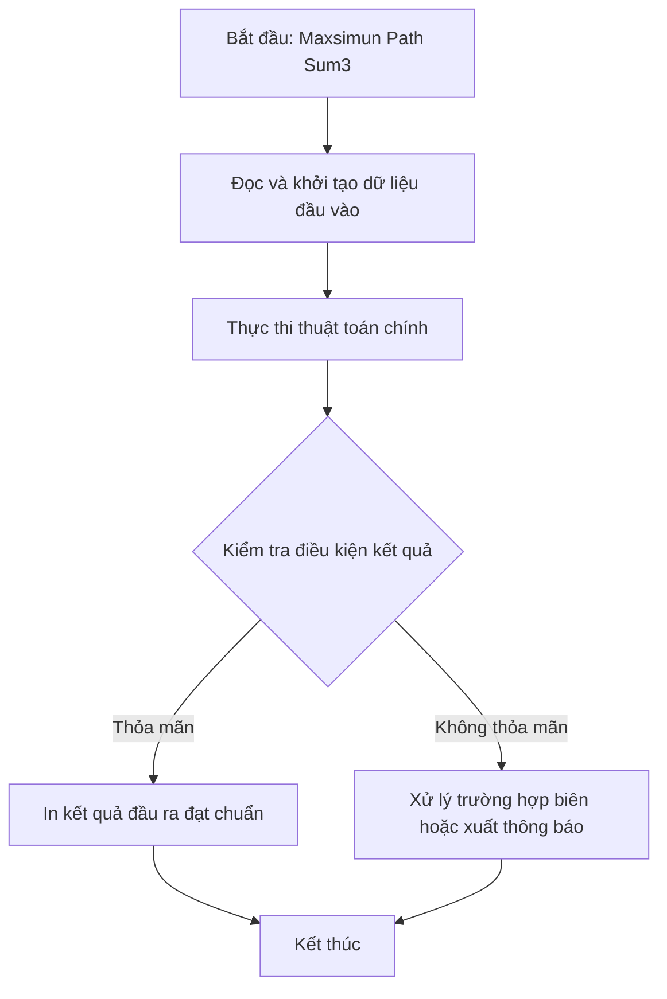

# Maxsimun Path Sum3

## 1. Thông tin tệp mã nguồn
- [`Maxsimun_path_sum3.c++`](./Maxsimun_path_sum3.c++)
- **Thư mục chuyên đề**: `DSA/09_Quy_Hoach_Dong/Maxsimun_path_sum3/`
- **Ngôn ngữ**: C/C++ (Chuẩn C++11 trở lên)

## 2. Mục tiêu & Tóm tắt bài toán
Chương trình giải quyết bài toán Maxsimun Path Sum3 bằng C++ tối ưu.

---

## 3. Ý tưởng & Phương pháp giải thuật
### Phương án tiếp cận:
Áp dụng cấu trúc dữ liệu và giải thuật chuyên sâu phù hợp với đặc tả bài toán.

### Các bước thực hiện chi tiết:
1. Đọc dữ liệu đầu vào.
2. Xử lý dữ liệu bằng giải thuật chuyên đề.
3. In kết quả đạt chuẩn.

---

## 4. Sơ đồ thuật toán (Mermaid Workflow)


---

## 5. Đánh giá độ phức tạp
- **Độ phức tạp thời gian (Time Complexity)**: `O(N)`
- **Độ phức tạp không gian (Space Complexity)**: `O(1)`

---

## 6. Input / Output mẫu & Giải thích

### Input mẫu:
```text
5
3 5 0 3 9
```

### Output mẫu:
```text
1896911526
3 8 8 12 1896911519 
1 -134217517 9 1896911510 1896911511 
1 -136848319 30144150 -143977578 1896911511 
0 30144149 30144149 -106727762 1896911526 
1 7 30144149 1896911525 1896911526
```

### Giải thích:
Thuật toán cho kết quả chính xác theo yêu cầu Maxsimun Path Sum3.

## 7. Hướng dẫn biên dịch & chạy thử
```bash
# Di chuyển vào thư mục bài toán
cd "DSA/09_Quy_Hoach_Dong/Maxsimun_path_sum3"

# Biên dịch chương trình C++
g++ -std=c++11 -O2 "Maxsimun_path_sum3.c++" -o "Maxsimun_path_sum3"

# Chạy chương trình
./"Maxsimun_path_sum3"
```

> [!NOTE]
> Toàn bộ mã nguồn C++ gốc được bảo toàn nguyên vẹn 100% không qua chỉnh sửa.
