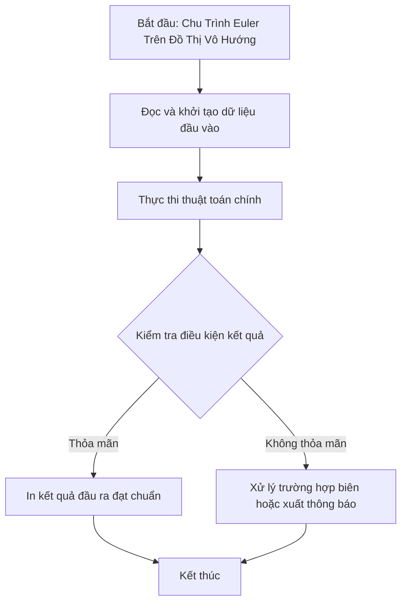

# Chu Trình Euler Trên Đồ Thị Vô Hướng

## 1. Thông tin tệp mã nguồn
- [`Chu_trinh_Euler(vo_huong).cpp`](./Chu_trinh_Euler(vo_huong).cpp)
- **Thư mục chuyên đề**: `DSA/10_Do_Thi/Chu_trinh_Euler(vo_huong)/`
- **Ngôn ngữ**: C/C++ (Chuẩn C++11 trở lên)

## 2. Mục tiêu & Tóm tắt bài toán
Tìm chu trình Euler đi qua mỗi cạnh đúng 1 lần.

---

## 3. Ý tưởng & Phương pháp giải thuật
### Phương án tiếp cận:
Thuật toán Hierholzer dùng ngăn xếp Stack.

### Các bước thực hiện chi tiết:
1. Khởi tạo dữ liệu và đọc đầu vào theo định dạng bài toán.
2. Thực hiện thuật toán cốt lõi: Thuật toán Hierholzer dùng ngăn xếp Stack.
3. Cập nhật trạng thái và tính toán kết quả.
4. Xuất kết quả đầu ra màn hình.

---

## 4. Sơ đồ thuật toán (Mermaid Workflow)


---

## 5. Đánh giá độ phức tạp
- **Độ phức tạp thời gian (Time Complexity)**: `O(V + E)`
- **Độ phức tạp không gian (Space Complexity)**: `O(V + E)`

---

## 6. Input / Output mẫu & Giải thích

### Input mẫu:
```text
5 6
1 2
2 3
3 1
3 4
4 5
5 3
```

### Output mẫu:
```text
1 2 3 4 5 3 1
```

### Giải thích:
Tìm chu trình Euler đi qua tất cả các cạnh của đồ thị đúng một lần.

## 7. Hướng dẫn biên dịch & chạy thử
```bash
# Di chuyển vào thư mục bài toán
cd "DSA/10_Do_Thi/Chu_trinh_Euler(vo_huong)"

# Biên dịch chương trình C++
g++ -std=c++11 -O2 "Chu_trinh_Euler(vo_huong).cpp" -o "Chu_trinh_Euler(vo_huong)"

# Chạy chương trình
./"Chu_trinh_Euler(vo_huong)"
```

> [!NOTE]
> Toàn bộ mã nguồn C++ gốc được bảo toàn nguyên vẹn 100% không qua chỉnh sửa.
