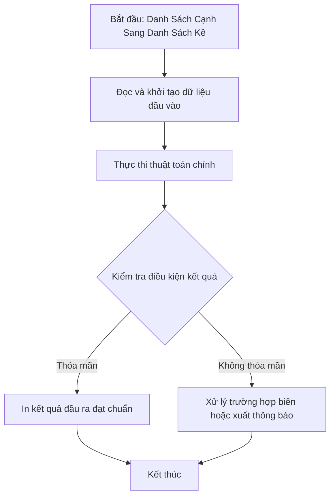

# Danh Sách Cạnh Sang Danh Sách Kề

## 1. Thông tin tệp mã nguồn
- [`Danh_sach_canhsang_Danh_sach_ke.cpp`](./Danh_sach_canhsang_Danh_sach_ke.cpp)
- **Thư mục chuyên đề**: `DSA/10_Do_Thi/Danh_sach_canhsang_Danh_sach_ke/`
- **Ngôn ngữ**: C/C++ (Chuẩn C++11 trở lên)

## 2. Mục tiêu & Tóm tắt bài toán
Chuyển danh sách cạnh thành danh sách kề.

---

## 3. Ý tưởng & Phương pháp giải thuật
### Phương án tiếp cận:
Thêm đỉnh vào vector adj[u] và adj[v].

### Các bước thực hiện chi tiết:
1. Khởi tạo dữ liệu và đọc đầu vào theo định dạng bài toán.
2. Thực hiện thuật toán cốt lõi: Thêm đỉnh vào vector adj[u] và adj[v].
3. Cập nhật trạng thái và tính toán kết quả.
4. Xuất kết quả đầu ra màn hình.

---

## 4. Sơ đồ thuật toán (Mermaid Workflow)


---

## 5. Đánh giá độ phức tạp
- **Độ phức tạp thời gian (Time Complexity)**: `O(V + E)`
- **Độ phức tạp không gian (Space Complexity)**: `O(V + E)`

---

## 6. Input / Output mẫu & Giải thích

### Input mẫu:
```text
5 9
1 2
1 3    1:2 3 4
1 4    2:1 3 4 5
2 3  =>3:1 2 3 5
2 4    4:1 2 3 5
2 5    5:2 3 4
3 4
3 5
4 5
```

### Output mẫu:
```text
1:2 3 0 0 0 0 0 0 0 
2:1 
3:1 
4:
5:
```

### Giải thích:
Danh sách kề.

## 7. Hướng dẫn biên dịch & chạy thử
```bash
# Di chuyển vào thư mục bài toán
cd "DSA/10_Do_Thi/Danh_sach_canhsang_Danh_sach_ke"

# Biên dịch chương trình C++
g++ -std=c++11 -O2 "Danh_sach_canhsang_Danh_sach_ke.cpp" -o "Danh_sach_canhsang_Danh_sach_ke"

# Chạy chương trình
./"Danh_sach_canhsang_Danh_sach_ke"
```

> [!NOTE]
> Toàn bộ mã nguồn C++ gốc được bảo toàn nguyên vẹn 100% không qua chỉnh sửa.
