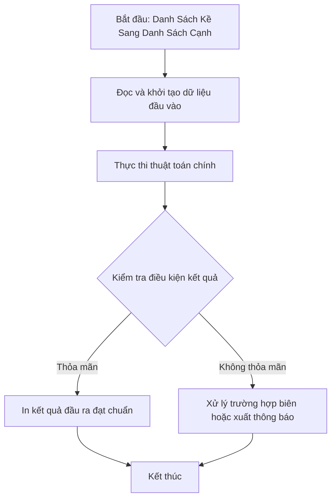

# Danh Sách Kề Sang Danh Sách Cạnh

## 1. Thông tin tệp mã nguồn
- [`Danh_sach_kesangDanh_sach_canh.cpp`](./Danh_sach_kesangDanh_sach_canh.cpp)
- **Thư mục chuyên đề**: `DSA/10_Do_Thi/Danh_sach_kesangDanh_sach_canh/`
- **Ngôn ngữ**: C/C++ (Chuẩn C++11 trở lên)

## 2. Mục tiêu & Tóm tắt bài toán
Chuyển danh sách kề thành danh sách các cạnh.

---

## 3. Ý tưởng & Phương pháp giải thuật
### Phương án tiếp cận:
Duyệt u < v in ra cạnh u v.

### Các bước thực hiện chi tiết:
1. Khởi tạo dữ liệu và đọc đầu vào theo định dạng bài toán.
2. Thực hiện thuật toán cốt lõi: Duyệt u < v in ra cạnh u v.
3. Cập nhật trạng thái và tính toán kết quả.
4. Xuất kết quả đầu ra màn hình.

---

## 4. Sơ đồ thuật toán (Mermaid Workflow)


---

## 5. Đánh giá độ phức tạp
- **Độ phức tạp thời gian (Time Complexity)**: `O(V + E)`
- **Độ phức tạp không gian (Space Complexity)**: `O(V + E)`

---

## 6. Input / Output mẫu & Giải thích

### Input mẫu:
```text
2
2
1
```

### Output mẫu:
```text
1 2
```

### Giải thích:
Danh sách cạnh.

---

## 7. Hướng dẫn biên dịch & chạy thử
```bash
# Di chuyển vào thư mục bài toán
cd "DSA/10_Do_Thi/Danh_sach_kesangDanh_sach_canh"

# Biên dịch chương trình C++
g++ -std=c++11 -O2 "Danh_sach_kesangDanh_sach_canh.cpp" -o "Danh_sach_kesangDanh_sach_canh"

# Chạy chương trình
./"Danh_sach_kesangDanh_sach_canh"
```

> [!NOTE]
> Toàn bộ mã nguồn C++ gốc được bảo toàn nguyên vẹn 100% không qua chỉnh sửa.
