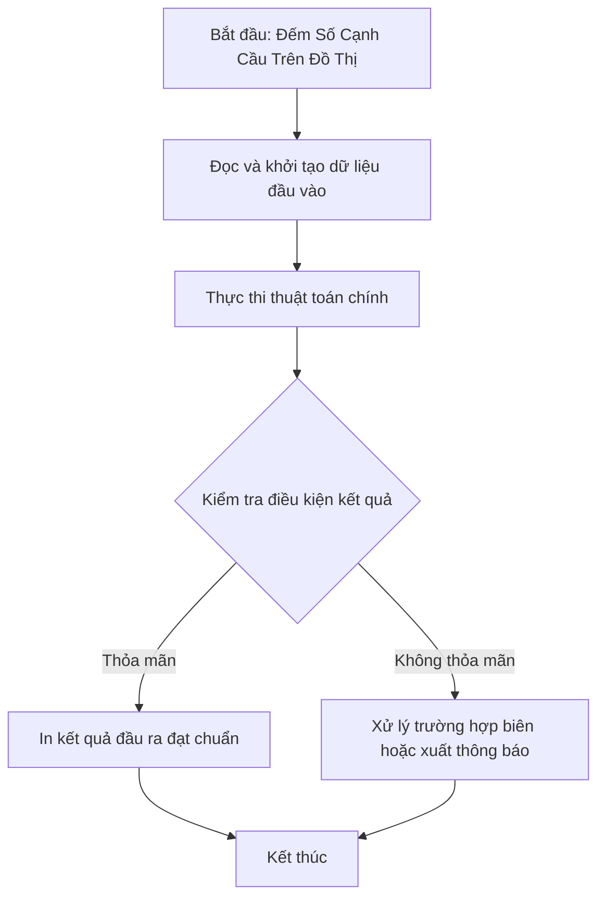

# Đếm Số Cạnh Cầu Trên Đồ Thị

## 1. Thông tin tệp mã nguồn
- [`Dem_so_canh_cau.cpp`](./Dem_so_canh_cau.cpp)
- **Thư mục chuyên đề**: `DSA/10_Do_Thi/Dem_so_canh_cau/`
- **Ngôn ngữ**: C/C++ (Chuẩn C++11 trở lên)

## 2. Mục tiêu & Tóm tắt bài toán
Đếm các cạnh cầu bằng thuật toán Tarjan (low[v] > disc[u]).

---

## 3. Ý tưởng & Phương pháp giải thuật
### Phương án tiếp cận:
Duyệt DFS tính mảng disc và low.

### Các bước thực hiện chi tiết:
1. Khởi tạo dữ liệu và đọc đầu vào theo định dạng bài toán.
2. Thực hiện thuật toán cốt lõi: Duyệt DFS tính mảng disc và low.
3. Cập nhật trạng thái và tính toán kết quả.
4. Xuất kết quả đầu ra màn hình.

---

## 4. Sơ đồ thuật toán (Mermaid Workflow)


---

## 5. Đánh giá độ phức tạp
- **Độ phức tạp thời gian (Time Complexity)**: `O(V + E)`
- **Độ phức tạp không gian (Space Complexity)**: `O(V + E)`

---

## 6. Input / Output mẫu & Giải thích

### Input mẫu:
```text
5 5
1 2
2 3
3 1
3 4
4 5
```

### Output mẫu:
```text
3 4
4 5

So canh cau:2
```

### Giải thích:
Có 2 cạnh cầu.

## 7. Hướng dẫn biên dịch & chạy thử
```bash
# Di chuyển vào thư mục bài toán
cd "DSA/10_Do_Thi/Dem_so_canh_cau"

# Biên dịch chương trình C++
g++ -std=c++11 -O2 "Dem_so_canh_cau.cpp" -o "Dem_so_canh_cau"

# Chạy chương trình
./"Dem_so_canh_cau"
```

> [!NOTE]
> Toàn bộ mã nguồn C++ gốc được bảo toàn nguyên vẹn 100% không qua chỉnh sửa.
