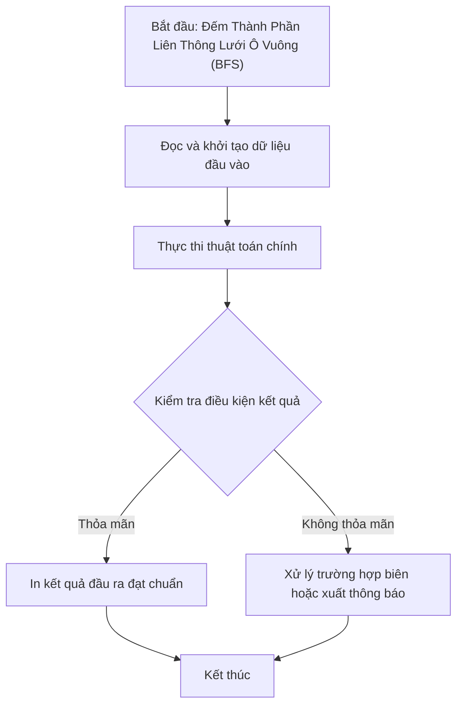

# Đếm Thành Phần Liên Thông Lưới Ô Vuông (BFS)

## 1. Thông tin tệp mã nguồn
- [`Dem_so_lien_thong_tren_luoi_do_thi(BFS).cpp`](./Dem_so_lien_thong_tren_luoi_do_thi(BFS).cpp)
- **Thư mục chuyên đề**: `DSA/10_Do_Thi/Dem_so_lien_thong_tren_luoi_do_thi(BFS)/`
- **Ngôn ngữ**: C/C++ (Chuẩn C++11 trở lên)

## 2. Mục tiêu & Tóm tắt bài toán
Đếm các miền ô số 1 liên thông trên ma trận bằng BFS.

---

## 3. Ý tưởng & Phương pháp giải thuật
### Phương án tiếp cận:
Hàng đợi BFS loang các ô kề cạnh.

### Các bước thực hiện chi tiết:
1. Khởi tạo dữ liệu và đọc đầu vào theo định dạng bài toán.
2. Thực hiện thuật toán cốt lõi: Hàng đợi BFS loang các ô kề cạnh.
3. Cập nhật trạng thái và tính toán kết quả.
4. Xuất kết quả đầu ra màn hình.

---

## 4. Sơ đồ thuật toán (Mermaid Workflow)


---

## 5. Đánh giá độ phức tạp
- **Độ phức tạp thời gian (Time Complexity)**: `O(N*M)`
- **Độ phức tạp không gian (Space Complexity)**: `O(N*M)`

---

## 6. Input / Output mẫu & Giải thích

### Input mẫu:
```text
3 3
1 1 0
0 0 1
1 0 1
```

### Output mẫu:
```text
Thanh phan lien thong thu 1 :
1 1
1 2
Thanh phan lien thong thu 2 :
2 3
3 3
Thanh phan lien thong thu 3 :
3 1
3
```

### Giải thích:
4 miền liên thông.

## 7. Hướng dẫn biên dịch & chạy thử
```bash
# Di chuyển vào thư mục bài toán
cd "DSA/10_Do_Thi/Dem_so_lien_thong_tren_luoi_do_thi(BFS)"

# Biên dịch chương trình C++
g++ -std=c++11 -O2 "Dem_so_lien_thong_tren_luoi_do_thi(BFS).cpp" -o "Dem_so_lien_thong_tren_luoi_do_thi(BFS)"

# Chạy chương trình
./"Dem_so_lien_thong_tren_luoi_do_thi(BFS)"
```

> [!NOTE]
> Toàn bộ mã nguồn C++ gốc được bảo toàn nguyên vẹn 100% không qua chỉnh sửa.
