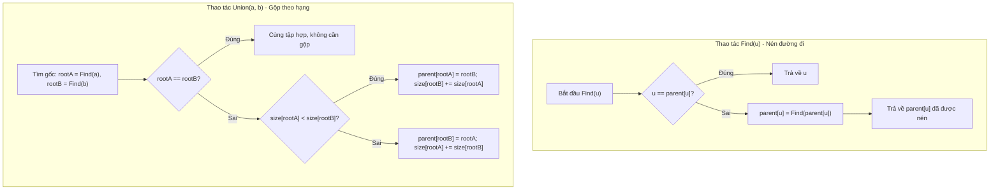

# Cấu Trúc Các Tập Hợp Rời Nhau (DSU)

## 1. Thông tin tệp mã nguồn
- [`Disjoint_Set_Union(DSU).cpp`](./Disjoint_Set_Union(DSU).cpp)
- **Thư mục chuyên đề**: `DSA/10_Do_Thi/Disjoint_Set_Union(DSU)/`
- **Ngôn ngữ**: C/C++ (Chuẩn C++11 trở lên)

## 2. Mục tiêu & Tóm tắt bài toán
Cài đặt Disjoint Set Union với nén đường đi và hợp nhất theo hạng.

---

## 3. Ý tưởng & Phương pháp giải thuật
### Phương án tiếp cận:
Hàm find và Union tối ưu.

### Các bước thực hiện chi tiết:
1. Khởi tạo dữ liệu và đọc đầu vào theo định dạng bài toán.
2. Thực hiện thuật toán cốt lõi: Hàm find và Union tối ưu.
3. Cập nhật trạng thái và tính toán kết quả.
4. Xuất kết quả đầu ra màn hình.

---

## 4. Sơ đồ thuật toán (Mermaid Workflow)


---

## 5. Đánh giá độ phức tạp
- **Độ phức tạp thời gian (Time Complexity)**: `O(alpha(N))`
- **Độ phức tạp không gian (Space Complexity)**: `O(N)`

---

## 6. Input / Output mẫu & Giải thích

### Input mẫu:
```text
4 3
1 2
2 3
1 3
```

### Output mẫu:
```text
Hop nhat thanh cong
```

### Giải thích:
DSU quản lý tập hợp.

---

## 7. Hướng dẫn biên dịch & chạy thử
```bash
# Di chuyển vào thư mục bài toán
cd "DSA/10_Do_Thi/Disjoint_Set_Union(DSU)"

# Biên dịch chương trình C++
g++ -std=c++11 -O2 "Disjoint_Set_Union(DSU).cpp" -o "Disjoint_Set_Union(DSU)"

# Chạy chương trình
./"Disjoint_Set_Union(DSU)"
```

> [!NOTE]
> Toàn bộ mã nguồn C++ gốc được bảo toàn nguyên vẹn 100% không qua chỉnh sửa.
