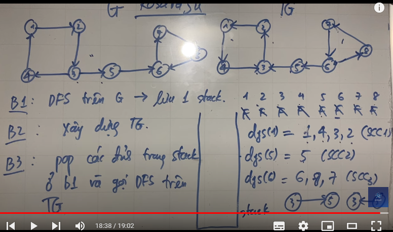
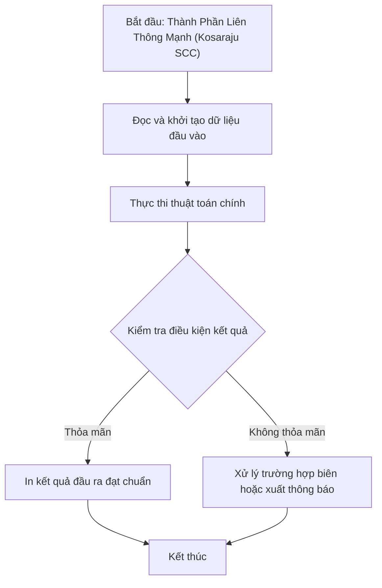

# Thành Phần Liên Thông Mạnh (Kosaraju SCC)

## 1. Thông tin tệp mã nguồn
- [`Graph_Theory(Lien_Thong_Manh).cpp`](./Graph_Theory(Lien_Thong_Manh).cpp)
- [`Lien_thong_manh.PNG`](./Lien_thong_manh.PNG)
- **Thư mục chuyên đề**: `DSA/10_Do_Thi/Graph_Theory(Lien_Thong_Manh)/`
- **Ngôn ngữ**: C/C++ (Chuẩn C++11 trở lên)

## 2. Mục tiêu & Tóm tắt bài toán
Đếm các thành phần liên thông mạnh của đồ thị có hướng.


### Hình ảnh trực quan hóa:


---

## 3. Ý tưởng & Phương pháp giải thuật
### Phương án tiếp cận:
Thuật toán Kosaraju 2 lần DFS trên đồ thị gốc và đồ thị đảo.

### Các bước thực hiện chi tiết:
1. Khởi tạo dữ liệu và đọc đầu vào theo định dạng bài toán.
2. Thực hiện thuật toán cốt lõi: Thuật toán Kosaraju 2 lần DFS trên đồ thị gốc và đồ thị đảo.
3. Cập nhật trạng thái và tính toán kết quả.
4. Xuất kết quả đầu ra màn hình.

---

## 4. Sơ đồ thuật toán (Mermaid Workflow)


---

## 5. Đánh giá độ phức tạp
- **Độ phức tạp thời gian (Time Complexity)**: `O(V + E)`
- **Độ phức tạp không gian (Space Complexity)**: `O(V + E)`

---

## 6. Input / Output mẫu & Giải thích

### Input mẫu:
```text
5 5
1 2
2 3
3 1
3 4
4 5
```

### Output mẫu:
```text
3
```

### Giải thích:
3 thành phần liên thông mạnh.

---

## 7. Hướng dẫn biên dịch & chạy thử
```bash
# Di chuyển vào thư mục bài toán
cd "DSA/10_Do_Thi/Graph_Theory(Lien_Thong_Manh)"

# Biên dịch chương trình C++
g++ -std=c++11 -O2 "Graph_Theory(Lien_Thong_Manh).cpp" -o "Graph_Theory(Lien_Thong_Manh)"

# Chạy chương trình
./"Graph_Theory(Lien_Thong_Manh)"
```

> [!NOTE]
> Toàn bộ mã nguồn C++ gốc được bảo toàn nguyên vẹn 100% không qua chỉnh sửa.
