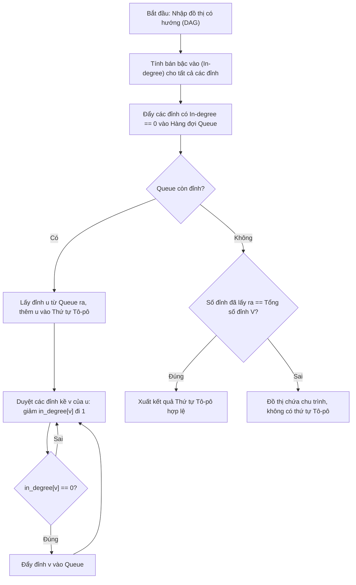

# Sắp Xếp Tô-pô (Topological Sort Bằng DFS)

## 1. Thông tin tệp mã nguồn
- [`Sap_xep_topo.cpp`](./Sap_xep_topo.cpp)
- **Thư mục chuyên đề**: `DSA/10_Do_Thi/Sap_xep_topo/`
- **Ngôn ngữ**: C/C++ (Chuẩn C++11 trở lên)

## 2. Mục tiêu & Tóm tắt bài toán
Sắp xếp thứ tự các đỉnh của đồ thị DAG bằng DFS.

---

## 3. Ý tưởng & Phương pháp giải thuật
### Phương án tiếp cận:
Đẩy đỉnh vào Stack sau khi duyệt xong tất cả con.

### Các bước thực hiện chi tiết:
1. Khởi tạo dữ liệu và đọc đầu vào theo định dạng bài toán.
2. Thực hiện thuật toán cốt lõi: Đẩy đỉnh vào Stack sau khi duyệt xong tất cả con.
3. Cập nhật trạng thái và tính toán kết quả.
4. Xuất kết quả đầu ra màn hình.

---

## 4. Sơ đồ thuật toán (Mermaid Workflow)


---

## 5. Đánh giá độ phức tạp
- **Độ phức tạp thời gian (Time Complexity)**: `O(V + E)`
- **Độ phức tạp không gian (Space Complexity)**: `O(V)`

---

## 6. Input / Output mẫu & Giải thích

### Input mẫu:
```text
4 4
1 2
1 3
2 4
3 4
```

### Output mẫu:
```text
1 3 2 4
```

### Giải thích:
Thứ tự tô-pô.

---

## 7. Hướng dẫn biên dịch & chạy thử
```bash
# Di chuyển vào thư mục bài toán
cd "DSA/10_Do_Thi/Sap_xep_topo"

# Biên dịch chương trình C++
g++ -std=c++11 -O2 "Sap_xep_topo.cpp" -o "Sap_xep_topo"

# Chạy chương trình
./"Sap_xep_topo"
```

> [!NOTE]
> Toàn bộ mã nguồn C++ gốc được bảo toàn nguyên vẹn 100% không qua chỉnh sửa.
