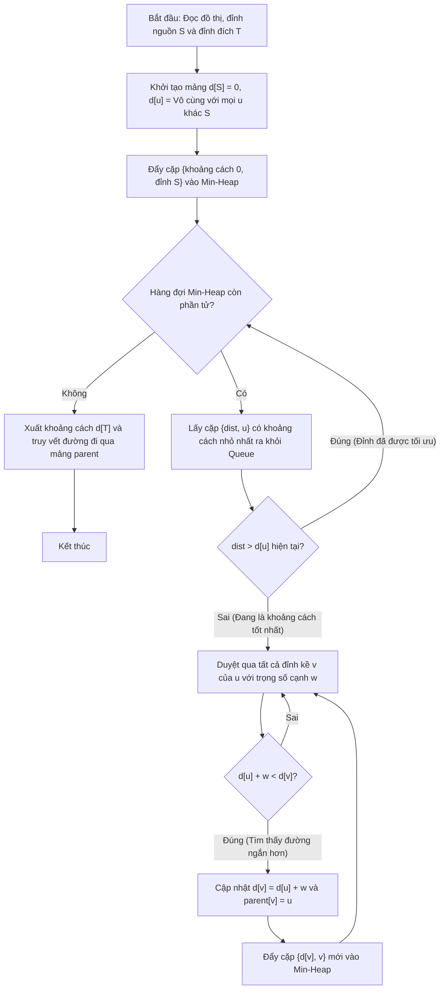

# Thuật Toán Dijkstra Tìm Đường Đi Ngắn Nhất

## 1. Thông tin tệp mã nguồn
- [`Tim_duong_di_ngan_nhat(Dijstra).cpp`](./Tim_duong_di_ngan_nhat(Dijstra).cpp)
- **Thư mục chuyên đề**: `DSA/10_Do_Thi/Tim_duong_di_ngan_nhat(Dijstra)/`
- **Ngôn ngữ**: C/C++ (Chuẩn C++11 trở lên)

## 2. Mục tiêu & Tóm tắt bài toán
Tìm khoảng cách ngắn nhất có trọng số không âm.

---

## 3. Ý tưởng & Phương pháp giải thuật
### Phương án tiếp cận:
Hàng đợi ưu tiên Min-Heap tối ưu hóa nhãn khoảng cách.

### Các bước thực hiện chi tiết:
1. Khởi tạo dữ liệu và đọc đầu vào theo định dạng bài toán.
2. Thực hiện thuật toán cốt lõi: Hàng đợi ưu tiên Min-Heap tối ưu hóa nhãn khoảng cách.
3. Cập nhật trạng thái và tính toán kết quả.
4. Xuất kết quả đầu ra màn hình.

---

## 4. Sơ đồ thuật toán (Mermaid Workflow)


---

## 5. Đánh giá độ phức tạp
- **Độ phức tạp thời gian (Time Complexity)**: `O((V + E) log V)`
- **Độ phức tạp không gian (Space Complexity)**: `O(V + E)`

---

## 6. Input / Output mẫu & Giải thích

### Input mẫu:
```text
3 3 1 3
1 2 1
2 3 2
1 3 5
```

### Output mẫu:
```text
3
1 2 3
```

### Giải thích:
Đường đi 1->2->3 ngắn nhất = 3.

## 7. Hướng dẫn biên dịch & chạy thử
```bash
# Di chuyển vào thư mục bài toán
cd "DSA/10_Do_Thi/Tim_duong_di_ngan_nhat(Dijstra)"

# Biên dịch chương trình C++
g++ -std=c++11 -O2 "Tim_duong_di_ngan_nhat(Dijstra).cpp" -o "Tim_duong_di_ngan_nhat(Dijstra)"

# Chạy chương trình
./"Tim_duong_di_ngan_nhat(Dijstra)"
```

> [!NOTE]
> Toàn bộ mã nguồn C++ gốc được bảo toàn nguyên vẹn 100% không qua chỉnh sửa.
