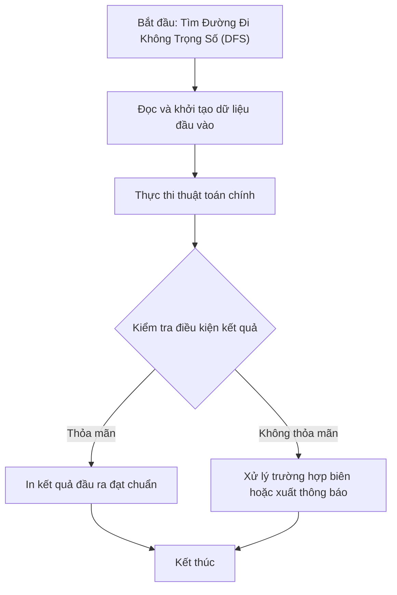

# Tìm Đường Đi Không Trọng Số (DFS)

## 1. Thông tin tệp mã nguồn
- [`Tim_duong_di_tren_do_thi_khong_co_trong_so(DFS).cpp`](./Tim_duong_di_tren_do_thi_khong_co_trong_so(DFS).cpp)
- **Thư mục chuyên đề**: `DSA/10_Do_Thi/Tim_duong_di_tren_do_thi_khong_co_trong_so(DFS)/`
- **Ngôn ngữ**: C/C++ (Chuẩn C++11 trở lên)

## 2. Mục tiêu & Tóm tắt bài toán
Tìm đường đi từ S đến T bằng DFS.

---

## 3. Ý tưởng & Phương pháp giải thuật
### Phương án tiếp cận:
DFS kết hợp mảng truy vết parent.

### Các bước thực hiện chi tiết:
1. Khởi tạo dữ liệu và đọc đầu vào theo định dạng bài toán.
2. Thực hiện thuật toán cốt lõi: DFS kết hợp mảng truy vết parent.
3. Cập nhật trạng thái và tính toán kết quả.
4. Xuất kết quả đầu ra màn hình.

---

## 4. Sơ đồ thuật toán (Mermaid Workflow)


---

## 5. Đánh giá độ phức tạp
- **Độ phức tạp thời gian (Time Complexity)**: `O(V + E)`
- **Độ phức tạp không gian (Space Complexity)**: `O(V)`

---

## 6. Input / Output mẫu & Giải thích

### Input mẫu:
```text
Ghi nhan cha cua x la u
Truy vet duong di
Bat dau tu dinh begin
```

### Output mẫu:
```text
Nhap dinh dau va cuoi:Co duong di!
0
```

### Giải thích:
Đường đi DFS.

## 7. Hướng dẫn biên dịch & chạy thử
```bash
# Di chuyển vào thư mục bài toán
cd "DSA/10_Do_Thi/Tim_duong_di_tren_do_thi_khong_co_trong_so(DFS)"

# Biên dịch chương trình C++
g++ -std=c++11 -O2 "Tim_duong_di_tren_do_thi_khong_co_trong_so(DFS).cpp" -o "Tim_duong_di_tren_do_thi_khong_co_trong_so(DFS)"

# Chạy chương trình
./"Tim_duong_di_tren_do_thi_khong_co_trong_so(DFS)"
```

> [!NOTE]
> Toàn bộ mã nguồn C++ gốc được bảo toàn nguyên vẹn 100% không qua chỉnh sửa.
