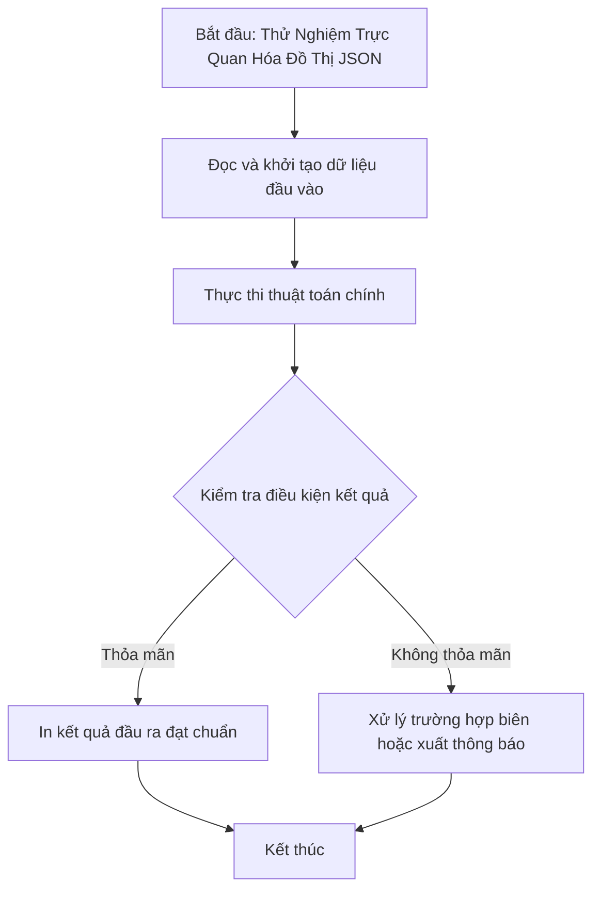

# Thử Nghiệm Trực Quan Hóa Đồ Thị JSON

## 1. Thông tin tệp mã nguồn
- [`test.cpp`](./test.cpp)
- **Thư mục chuyên đề**: `DSA/10_Do_Thi/test/`
- **Ngôn ngữ**: C/C++ (Chuẩn C++11 trở lên)

## 2. Mục tiêu & Tóm tắt bài toán
Xuất chuỗi định dạng JSON đại diện cho đồ thị có hướng để trực quan hóa đồ thị.

---

## 3. Ý tưởng & Phương pháp giải thuật
### Phương án tiếp cận:
Tạo chuỗi JSON chứa các node và edge rồi in ra màn hình.

### Các bước thực hiện chi tiết:
1. Khởi tạo dữ liệu và đọc đầu vào theo định dạng bài toán.
2. Thực hiện thuật toán cốt lõi: Định dạng JSON node và edge.
3. Cập nhật trạng thái và tính toán kết quả.
4. Xuất kết quả đầu ra màn hình.

---

## 4. Sơ đồ thuật toán (Mermaid Workflow)


---

## 5. Đánh giá độ phức tạp
- **Độ phức tạp thời gian (Time Complexity)**: `O(1)`
- **Độ phức tạp không gian (Space Complexity)**: `O(1)`

---

## 6. Input / Output mẫu & Giải thích

### Input mẫu:
```text
Không yêu cầu tham số đầu vào
```

### Output mẫu:
```text
{"kind":{"graph":true},"nodes":[{"id":"1"},{"id":"2"}],"edges":[{"from":"1","to":"2"}]}
```

### Giải thích:
Đồ thị có hướng gồm 2 đỉnh 1, 2 và một cung nối từ đỉnh 1 sang đỉnh 2.

## 7. Hướng dẫn biên dịch & chạy thử
```bash
# Di chuyển vào thư mục bài toán
cd "DSA/10_Do_Thi/test"

# Biên dịch chương trình C++
g++ -std=c++11 -O2 "test.cpp" -o "test"

# Chạy chương trình
./"test"
```

> [!NOTE]
> Toàn bộ mã nguồn C++ gốc được bảo toàn nguyên vẹn 100% không qua chỉnh sửa.
