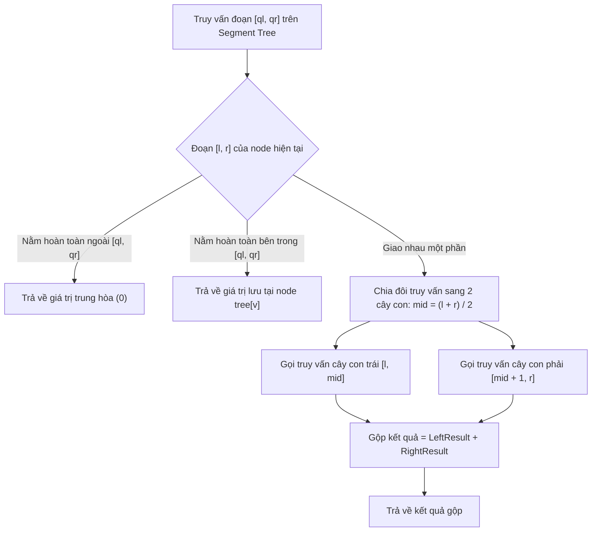

# Cây Phân Đoạn (Segment Tree)

## 1. Thông tin tệp mã nguồn
- [`Segment_Tree.cpp`](./Segment_Tree.cpp)
- **Thư mục chuyên đề**: `DSA/11_Cay_va_Cau_Truc_Nang_Cao/Segment_Tree/`
- **Ngôn ngữ**: C/C++ (Chuẩn C++11 trở lên)

## 2. Mục tiêu & Tóm tắt bài toán
Cập nhật giá trị và truy vấn tổng đoạn trong O(log N).

---

## 3. Ý tưởng & Phương pháp giải thuật
### Phương án tiếp cận:
Cây nhị phân hoàn chỉnh quản lý các đoạn con.

### Các bước thực hiện chi tiết:
1. Khởi tạo dữ liệu và đọc đầu vào theo định dạng bài toán.
2. Thực hiện thuật toán cốt lõi: Cây nhị phân hoàn chỉnh quản lý các đoạn con.
3. Cập nhật trạng thái và tính toán kết quả.
4. Xuất kết quả đầu ra màn hình.

---

## 4. Sơ đồ thuật toán (Mermaid Workflow)


---

## 5. Đánh giá độ phức tạp
- **Độ phức tạp thời gian (Time Complexity)**: `O(log N)`
- **Độ phức tạp không gian (Space Complexity)**: `O(4N)`

---

## 6. Input / Output mẫu & Giải thích

### Input mẫu:
```text
5
1 3 5 7 9
query 1 3
```

### Output mẫu:
```text
9
```

### Giải thích:
Truy vấn tổng đoạn [1, 3] = 1 + 3 + 5 = 9 sử dụng Segment Tree với độ phức tạp O(log N).

## 7. Hướng dẫn biên dịch & chạy thử
```bash
# Di chuyển vào thư mục bài toán
cd "DSA/11_Cay_va_Cau_Truc_Nang_Cao/Segment_Tree"

# Biên dịch chương trình C++
g++ -std=c++11 -O2 "Segment_Tree.cpp" -o "Segment_Tree"

# Chạy chương trình
./"Segment_Tree"
```

> [!NOTE]
> Toàn bộ mã nguồn C++ gốc được bảo toàn nguyên vẹn 100% không qua chỉnh sửa.
