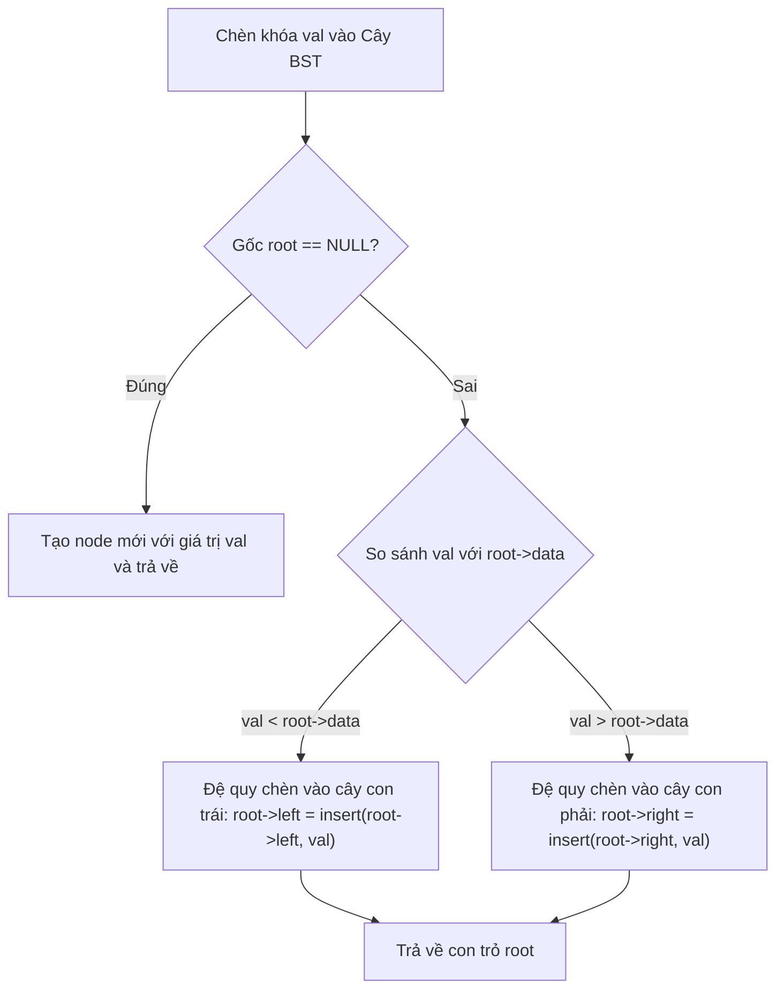

# Khởi Tạo & Duyệt Cây Nhị Phân Tìm Kiếm (BST)

## 1. Thông tin tệp mã nguồn
- [`Tao_DuyetCNP.cpp`](./Tao_DuyetCNP.cpp)
- **Thư mục chuyên đề**: `DSA/11_Cay_va_Cau_Truc_Nang_Cao/Tao_DuyetCNP/`
- **Ngôn ngữ**: C/C++ (Chuẩn C++11 trở lên)

## 2. Mục tiêu & Tóm tắt bài toán
Chèn node vào BST và duyệt theo thứ tự LNR, NLR, LRN.

---

## 3. Ý tưởng & Phương pháp giải thuật
### Phương án tiếp cận:
Cây con trái nhỏ hơn node gốc, cây con phải lớn hơn node gốc.

### Các bước thực hiện chi tiết:
1. Khởi tạo dữ liệu và đọc đầu vào theo định dạng bài toán.
2. Thực hiện thuật toán cốt lõi: Cây con trái nhỏ hơn node gốc, cây con phải lớn hơn node gốc.
3. Cập nhật trạng thái và tính toán kết quả.
4. Xuất kết quả đầu ra màn hình.

---

## 4. Sơ đồ thuật toán (Mermaid Workflow)


---

## 5. Đánh giá độ phức tạp
- **Độ phức tạp thời gian (Time Complexity)**: `O(N) duyệt, O(log N) chèn`
- **Độ phức tạp không gian (Space Complexity)**: `O(h)`

---

## 6. Input / Output mẫu & Giải thích

### Input mẫu:
```text
Không yêu cầu tham số đầu vào (dữ liệu được khởi tạo trực tiếp trong mã nguồn)
```

### Output mẫu:
```text
37 41 46 50 33 6 7 15 17 23
```

### Giải thích:
Chương trình thực thi và xuất kết quả trực tiếp từ dữ liệu mẫu trong mã nguồn.

## 7. Hướng dẫn biên dịch & chạy thử
```bash
# Di chuyển vào thư mục bài toán
cd "DSA/11_Cay_va_Cau_Truc_Nang_Cao/Tao_DuyetCNP"

# Biên dịch chương trình C++
g++ -std=c++11 -O2 "Tao_DuyetCNP.cpp" -o "Tao_DuyetCNP"

# Chạy chương trình
./"Tao_DuyetCNP"
```

> [!NOTE]
> Toàn bộ mã nguồn C++ gốc được bảo toàn nguyên vẹn 100% không qua chỉnh sửa.
