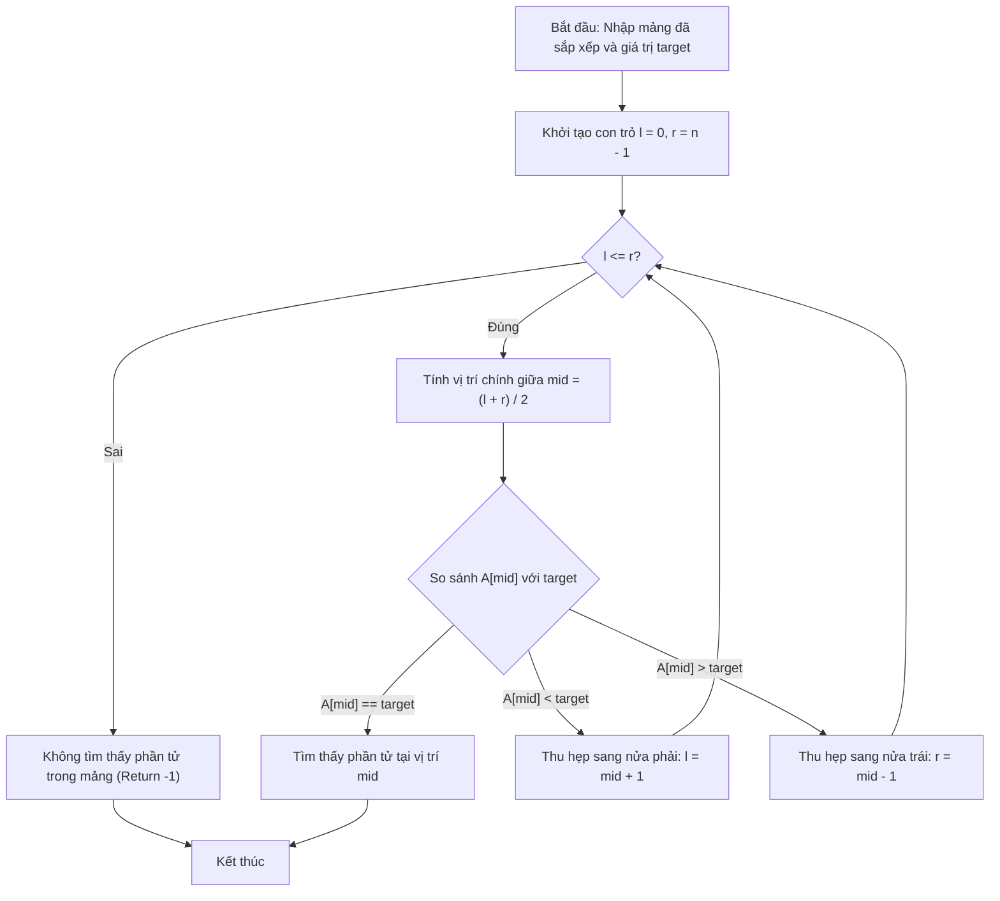

# Tìm Kiếm Trên Cây Nhị Phân Tìm Kiếm (BST)

## 1. Thông tin tệp mã nguồn
- [`Timkiem.cpp`](./Timkiem.cpp)
- **Thư mục chuyên đề**: `DSA/11_Cay_va_Cau_Truc_Nang_Cao/Timkiem/`
- **Ngôn ngữ**: C/C++ (Chuẩn C++11 trở lên)

## 2. Mục tiêu & Tóm tắt bài toán
Tìm kiếm sự tồn tại của khóa key trên BST trong O(h).

---

## 3. Ý tưởng & Phương pháp giải thuật
### Phương án tiếp cận:
Đệ quy so sánh key với giá trị node hiện tại.

### Các bước thực hiện chi tiết:
1. Khởi tạo dữ liệu và đọc đầu vào theo định dạng bài toán.
2. Thực hiện thuật toán cốt lõi: Đệ quy so sánh key với giá trị node hiện tại.
3. Cập nhật trạng thái và tính toán kết quả.
4. Xuất kết quả đầu ra màn hình.

---

## 4. Sơ đồ thuật toán (Mermaid Workflow)


---

## 5. Đánh giá độ phức tạp
- **Độ phức tạp thời gian (Time Complexity)**: `O(h) với h là chiều cao cây`
- **Độ phức tạp không gian (Space Complexity)**: `O(h)`

---

## 6. Input / Output mẫu & Giải thích

### Input mẫu:
```text
5 30
40 20 60 10 30
```

### Output mẫu:
```text
Nhap phan tu can tim kiem:5 co ton tai!
1 2 3 4 5 6 7 8 9 10 Nhap phan tu can xoa:
```

### Giải thích:
30 có trong cây BST.

## 7. Hướng dẫn biên dịch & chạy thử
```bash
# Di chuyển vào thư mục bài toán
cd "DSA/11_Cay_va_Cau_Truc_Nang_Cao/Timkiem"

# Biên dịch chương trình C++
g++ -std=c++11 -O2 "Timkiem.cpp" -o "Timkiem"

# Chạy chương trình
./"Timkiem"
```

> [!NOTE]
> Toàn bộ mã nguồn C++ gốc được bảo toàn nguyên vẹn 100% không qua chỉnh sửa.
