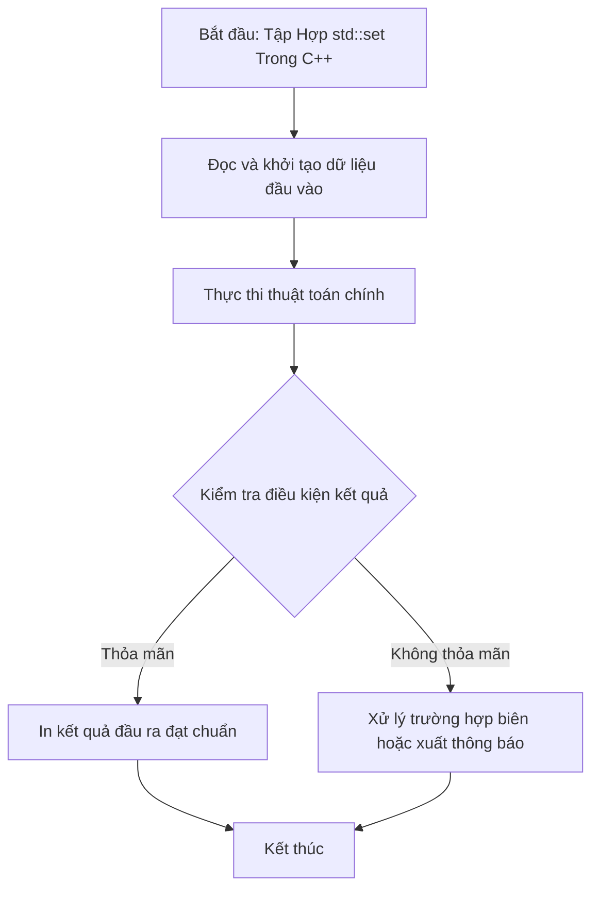

# Tập Hợp std::set Trong C++

## 1. Thông tin tệp mã nguồn
- [`Set.cpp`](./Set.cpp)
- **Thư mục chuyên đề**: `DSA/12_STL_Containers/Set/`
- **Ngôn ngữ**: C/C++ (Chuẩn C++11 trở lên)

## 2. Mục tiêu & Tóm tắt bài toán
Container std::set tự động loại bỏ trùng lặp và sắp xếp phần tử tăng dần.

---

## 3. Ý tưởng & Phương pháp giải thuật
### Phương án tiếp cận:
Cây đỏ đen (Red-Black Tree) cân bằng.

### Các bước thực hiện chi tiết:
1. Khởi tạo dữ liệu và đọc đầu vào theo định dạng bài toán.
2. Thực hiện thuật toán cốt lõi: Cây đỏ đen (Red-Black Tree) cân bằng.
3. Cập nhật trạng thái và tính toán kết quả.
4. Xuất kết quả đầu ra màn hình.

---

## 4. Sơ đồ thuật toán (Mermaid Workflow)


---

## 5. Đánh giá độ phức tạp
- **Độ phức tạp thời gian (Time Complexity)**: `O(log N) mỗi thao tác`
- **Độ phức tạp không gian (Space Complexity)**: `O(N)`

---

## 6. Input / Output mẫu & Giải thích

### Input mẫu:
```text
tinh chat ham set
tu dong xoa so hoac ki tu trung voi ki tu co trong set
tu xap sep theo thu tu tang dan neu la so va ki tu
ham tim kiem trong set
neu tim thay thi no se tra ve vi tri cua phan tu do
con khong tim thay thi no se tra ve gia tri s.end()
neu muon xoa phan tu bat ki trong set
ta dung s.erase("phan tu muon xoa")
ham multiset giong ham set
chi khac nhau la multiset khong xoa cac phantu trong nhau
```

### Output mẫu:
```text
4
2 3 4 5 FOUNDNhap kich thuoc:
3
```

### Giải thích:
Tự động loại trùng và sắp xếp.

## 7. Hướng dẫn biên dịch & chạy thử
```bash
# Di chuyển vào thư mục bài toán
cd "DSA/12_STL_Containers/Set"

# Biên dịch chương trình C++
g++ -std=c++11 -O2 "Set.cpp" -o "Set"

# Chạy chương trình
./"Set"
```

> [!NOTE]
> Toàn bộ mã nguồn C++ gốc được bảo toàn nguyên vẹn 100% không qua chỉnh sửa.
