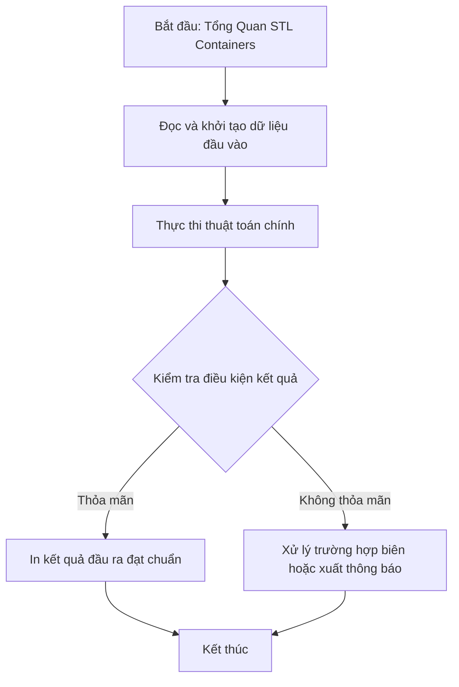

# Tổng Quan STL Containers

## 1. Thông tin tệp mã nguồn
- [`Vector,Iterator,Pair,Set.cpp`](./Vector,Iterator,Pair,Set.cpp)
- **Thư mục chuyên đề**: `DSA/12_STL_Containers/Vector,Iterator,Pair,Set/`
- **Ngôn ngữ**: C/C++ (Chuẩn C++11 trở lên)

## 2. Mục tiêu & Tóm tắt bài toán
Tổng hợp các thao tác cơ bản với std::vector, std::pair và Iterator trong C++ STL.

---

## 3. Ý tưởng & Phương pháp giải thuật
### Phương án tiếp cận:
Minh họa khởi tạo, push_back, duyệt vector bằng for/iterator, chèn insert, pair lồng nhau.

### Các bước thực hiện chi tiết:
1. Khởi tạo dữ liệu và đọc đầu vào theo định dạng bài toán.
2. Thực hiện thuật toán cốt lõi: Các container cốt lõi trong C++ Standard Template Library.
3. Cập nhật trạng thái và tính toán kết quả.
4. Xuất kết quả đầu ra màn hình.

---

## 4. Sơ đồ thuật toán (Mermaid Workflow)


---

## 5. Đánh giá độ phức tạp
- **Độ phức tạp thời gian (Time Complexity)**: `O(1) đến O(log N)`
- **Độ phức tạp không gian (Space Complexity)**: `O(N)`

---

## 6. Input / Output mẫu & Giải thích

### Input mẫu:
```text
3
10 20 30
```

### Output mẫu:
```text
4
1
cach duyet for 13,2,1,4,
3
3 3 3 3 
Nhap so phan tu vector10 20 30 
10 20
10 20
10 20  30
```

### Giải thích:
Vector ban đầu có 4 phần tử {3,2,1,4}, sau đó nhập thêm vector b gồm 3 phần tử {10,20,30} và minh họa thao tác truy cập cặp giá trị std::pair.

## 7. Hướng dẫn biên dịch & chạy thử
```bash
# Di chuyển vào thư mục bài toán
cd "DSA/12_STL_Containers/Vector,Iterator,Pair,Set"

# Biên dịch chương trình C++
g++ -std=c++11 -O2 "Vector,Iterator,Pair,Set.cpp" -o "Vector,Iterator,Pair,Set"

# Chạy chương trình
./"Vector,Iterator,Pair,Set"
```

> [!NOTE]
> Toàn bộ mã nguồn C++ gốc được bảo toàn nguyên vẹn 100% không qua chỉnh sửa.
