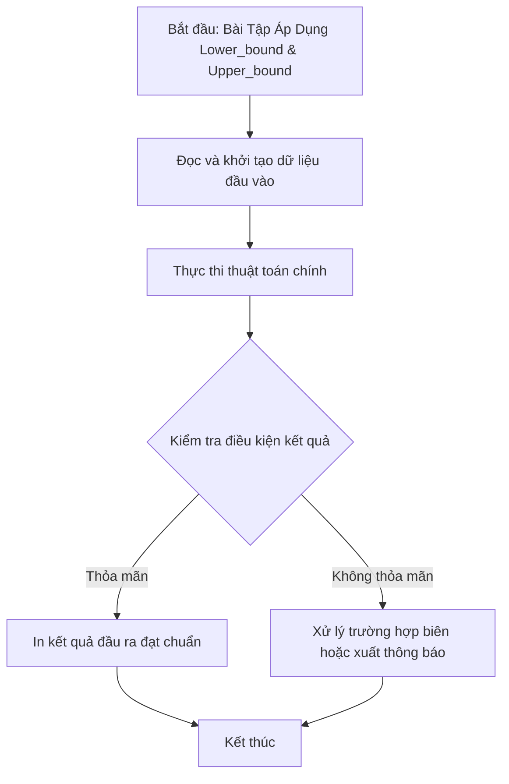

# Bài Tập Áp Dụng Lower_bound & Upper_bound

## 1. Thông tin tệp mã nguồn
- [`bt lower,upper.cpp`](./bt lower,upper.cpp)
- **Thư mục chuyên đề**: `DSA/12_STL_Containers/bt lower,upper/`
- **Ngôn ngữ**: C/C++ (Chuẩn C++11 trở lên)

## 2. Mục tiêu & Tóm tắt bài toán
Tìm số lần xuất hiện của phần tử X bằng hiệu upper_bound - lower_bound.

---

## 3. Ý tưởng & Phương pháp giải thuật
### Phương án tiếp cận:
Tìm kiếm nhị phân trên mảng đã sắp xếp.

### Các bước thực hiện chi tiết:
1. Khởi tạo dữ liệu và đọc đầu vào theo định dạng bài toán.
2. Thực hiện thuật toán cốt lõi: Tìm kiếm nhị phân trên mảng đã sắp xếp.
3. Cập nhật trạng thái và tính toán kết quả.
4. Xuất kết quả đầu ra màn hình.

---

## 4. Sơ đồ thuật toán (Mermaid Workflow)


---

## 5. Đánh giá độ phức tạp
- **Độ phức tạp thời gian (Time Complexity)**: `O(log N)`
- **Độ phức tạp không gian (Space Complexity)**: `O(1)`

---

## 6. Input / Output mẫu & Giải thích

### Input mẫu:
```text
6 4
1 2 4 4 4 5
```

### Output mẫu:
```text
nhap so can tim:Vi tri dau tien phan tu>= n trong mang:8
Vi tri cuoi cung cua phan tu> n trong mang:9
Vi tri dau tien cua n trong mang:8
Vi tri cuoi cung cua n trong mang:8
so lan xuat hien cua n:1
```

### Giải thích:
Hiệu 2 cận cho số lần xuất hiện.

## 7. Hướng dẫn biên dịch & chạy thử
```bash
# Di chuyển vào thư mục bài toán
cd "DSA/12_STL_Containers/bt lower,upper"

# Biên dịch chương trình C++
g++ -std=c++11 -O2 "bt lower,upper.cpp" -o "bt lower,upper"

# Chạy chương trình
./"bt lower,upper"
```

> [!NOTE]
> Toàn bộ mã nguồn C++ gốc được bảo toàn nguyên vẹn 100% không qua chỉnh sửa.
