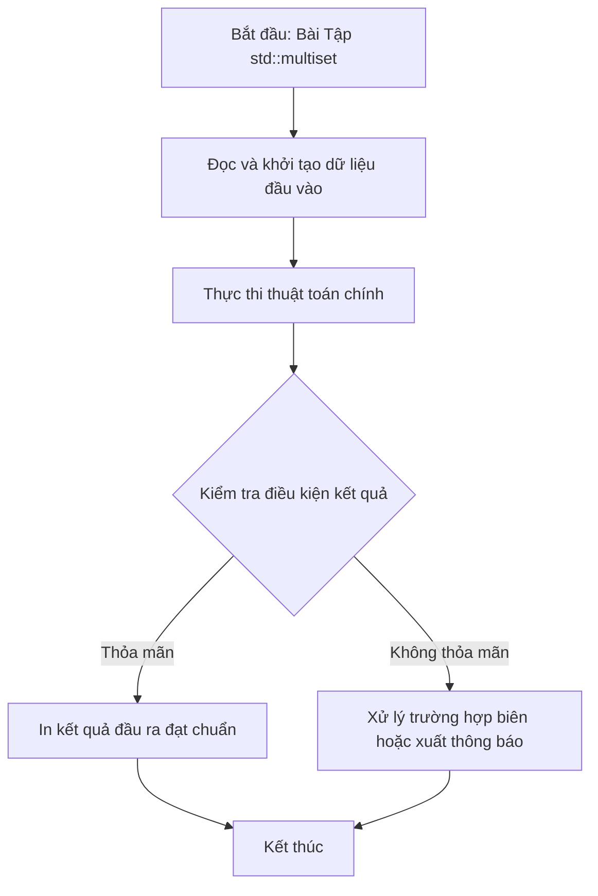

# Bài Tập std::multiset

## 1. Thông tin tệp mã nguồn
- [`bt multiset.cpp`](./bt multiset.cpp)
- **Thư mục chuyên đề**: `DSA/12_STL_Containers/bt multiset/`
- **Ngôn ngữ**: C/C++ (Chuẩn C++11 trở lên)

## 2. Mục tiêu & Tóm tắt bài toán
Container multiset cho phép lưu trữ các phần tử trùng lặp có thứ tự.

---

## 3. Ý tưởng & Phương pháp giải thuật
### Phương án tiếp cận:
Cây nhị phân tìm kiếm tự cân bằng.

### Các bước thực hiện chi tiết:
1. Khởi tạo dữ liệu và đọc đầu vào theo định dạng bài toán.
2. Thực hiện thuật toán cốt lõi: Cây nhị phân tìm kiếm tự cân bằng.
3. Cập nhật trạng thái và tính toán kết quả.
4. Xuất kết quả đầu ra màn hình.

---

## 4. Sơ đồ thuật toán (Mermaid Workflow)


---

## 5. Đánh giá độ phức tạp
- **Độ phức tạp thời gian (Time Complexity)**: `O(log N)`
- **Độ phức tạp không gian (Space Complexity)**: `O(N)`

---

## 6. Input / Output mẫu & Giải thích

### Input mẫu:
```text
5
4 2 2 8 4
```

### Output mẫu:
```text
8 8
```

### Giải thích:
Lưu phần tử trùng có thứ tự.

## 7. Hướng dẫn biên dịch & chạy thử
```bash
# Di chuyển vào thư mục bài toán
cd "DSA/12_STL_Containers/bt multiset"

# Biên dịch chương trình C++
g++ -std=c++11 -O2 "bt multiset.cpp" -o "bt multiset"

# Chạy chương trình
./"bt multiset"
```

> [!NOTE]
> Toàn bộ mã nguồn C++ gốc được bảo toàn nguyên vẹn 100% không qua chỉnh sửa.
