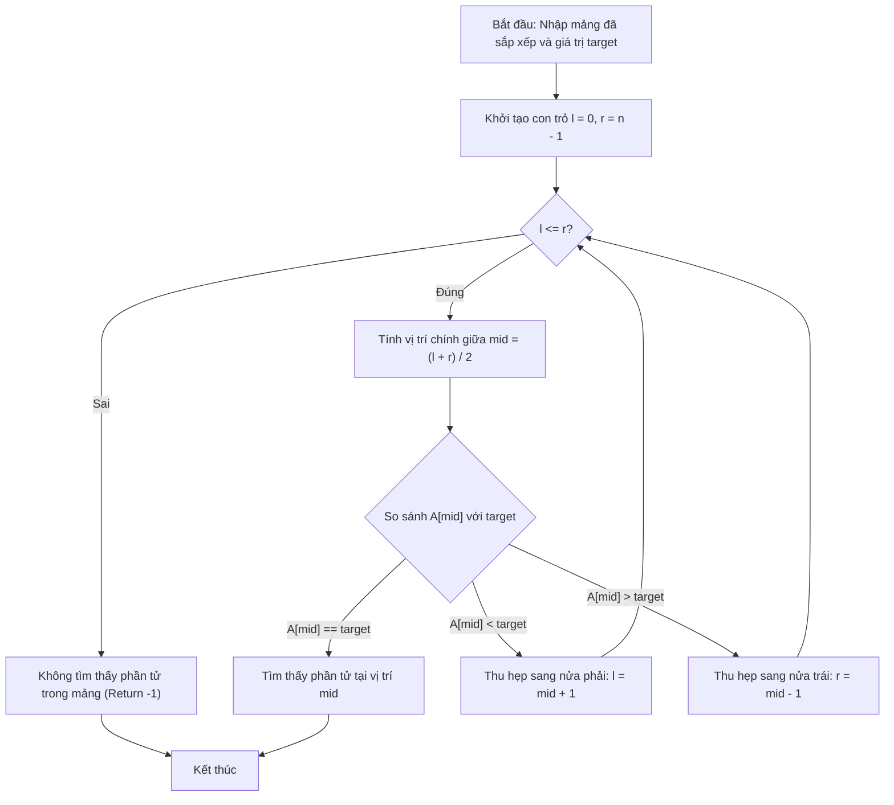

# Các Hàm Tìm Kiếm & Sắp Xếp STL

## 1. Thông tin tệp mã nguồn
- [`ham sort,binary_search,lower_bound,upper_bound.cpp`](./ham sort,binary_search,lower_bound,upper_bound.cpp)
- **Thư mục chuyên đề**: `DSA/12_STL_Containers/ham sort,binary_search,lower_bound,upper_bound/`
- **Ngôn ngữ**: C/C++ (Chuẩn C++11 trở lên)

## 2. Mục tiêu & Tóm tắt bài toán
Sử dụng sort, binary_search, lower_bound, upper_bound trong C++.

---

## 3. Ý tưởng & Phương pháp giải thuật
### Phương án tiếp cận:
Thuật toán tìm kiếm nhị phân chuẩn hóa sẵn trong STL.

### Các bước thực hiện chi tiết:
1. Khởi tạo dữ liệu và đọc đầu vào theo định dạng bài toán.
2. Thực hiện thuật toán cốt lõi: Thuật toán tìm kiếm nhị phân chuẩn hóa sẵn trong STL.
3. Cập nhật trạng thái và tính toán kết quả.
4. Xuất kết quả đầu ra màn hình.

---

## 4. Sơ đồ thuật toán (Mermaid Workflow)


---

## 5. Đánh giá độ phức tạp
- **Độ phức tạp thời gian (Time Complexity)**: `O(log N)`
- **Độ phức tạp không gian (Space Complexity)**: `O(1)`

---

## 6. Input / Output mẫu & Giải thích

### Input mẫu:
```text
7
1 2 4 4 5 6 8
4
```

### Output mẫu:
```text
Tim thay 4: Co (binary_search)
Vi tri lower_bound(4): 2 (gia tri = 4)
Vi tri upper_bound(4): 4 (gia tri = 5)
```

### Giải thích:
Minh họa các hàm tìm kiếm nhị phân trên dãy đã sắp xếp trong header <algorithm>.

## 7. Hướng dẫn biên dịch & chạy thử
```bash
# Di chuyển vào thư mục bài toán
cd "DSA/12_STL_Containers/ham sort,binary_search,lower_bound,upper_bound"

# Biên dịch chương trình C++
g++ -std=c++11 -O2 "ham sort,binary_search,lower_bound,upper_bound.cpp" -o "ham sort,binary_search,lower_bound,upper_bound"

# Chạy chương trình
./"ham sort,binary_search,lower_bound,upper_bound"
```

> [!NOTE]
> Toàn bộ mã nguồn C++ gốc được bảo toàn nguyên vẹn 100% không qua chỉnh sửa.
