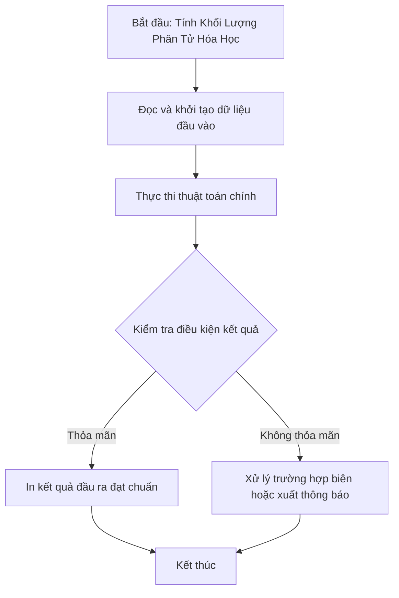

# Tính Khối Lượng Phân Tử Hóa Học

## 1. Thông tin tệp mã nguồn
- [`28tech_Chemistry.cpp`](./28tech_Chemistry.cpp)
- **Thư mục chuyên đề**: `DSA/13_Luyen_De_va_Tong_Hop/28tech_Chemistry/`
- **Ngôn ngữ**: C/C++ (Chuẩn C++11 trở lên)

## 2. Mục tiêu & Tóm tắt bài toán
Tính khối lượng phân tử từ công thức hóa học cho trước.

---

## 3. Ý tưởng & Phương pháp giải thuật
### Phương án tiếp cận:
Tách tên nguyên tố và chỉ số số lượng nguyên tử.

### Các bước thực hiện chi tiết:
1. Khởi tạo dữ liệu và đọc đầu vào theo định dạng bài toán.
2. Thực hiện thuật toán cốt lõi: Tách tên nguyên tố và chỉ số số lượng nguyên tử.
3. Cập nhật trạng thái và tính toán kết quả.
4. Xuất kết quả đầu ra màn hình.

---

## 4. Sơ đồ thuật toán (Mermaid Workflow)


---

## 5. Đánh giá độ phức tạp
- **Độ phức tạp thời gian (Time Complexity)**: `O(L)`
- **Độ phức tạp không gian (Space Complexity)**: `O(1)`

---

## 6. Input / Output mẫu & Giải thích

### Input mẫu:
```text
6
H7Al6O7
Ca3Al4P7
N3He7K4
F5F6He6
He5Ca4N3
Ca6H6N7
```

### Output mẫu:
```text
281
445
226
233
222
344
```

### Giải thích:
Tính phân tử khối của từng công thức hóa học: H7Al6O7 = 7*1 + 6*27 + 7*16 = 281; Ca3Al4P7 = 3*40 + 4*27 + 7*31 = 445,...

## 7. Hướng dẫn biên dịch & chạy thử
```bash
# Di chuyển vào thư mục bài toán
cd "DSA/13_Luyen_De_va_Tong_Hop/28tech_Chemistry"

# Biên dịch chương trình C++
g++ -std=c++11 -O2 "28tech_Chemistry.cpp" -o "28tech_Chemistry"

# Chạy chương trình
./"28tech_Chemistry"
```

> [!NOTE]
> Toàn bộ mã nguồn C++ gốc được bảo toàn nguyên vẹn 100% không qua chỉnh sửa.
