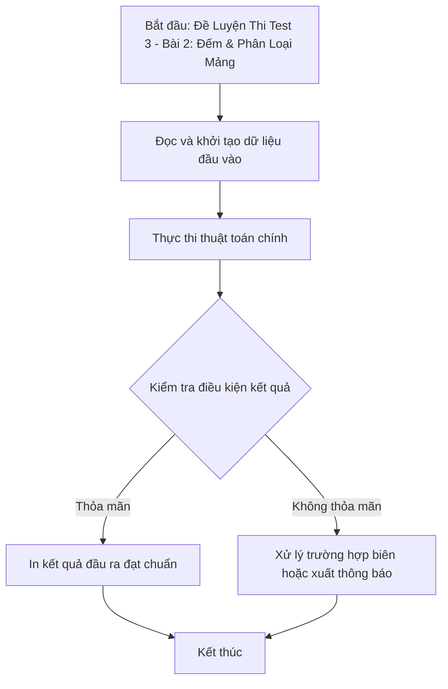

# Đề Luyện Thi Test 3 - Bài 2: Đếm & Phân Loại Mảng

## 1. Thông tin tệp mã nguồn
- [`Bai2_test3.cpp`](./Bai2_test3.cpp)
- **Thư mục chuyên đề**: `DSA/13_Luyen_De_va_Tong_Hop/Bai2_test3/`
- **Ngôn ngữ**: C/C++ (Chuẩn C++11 trở lên)

## 2. Mục tiêu & Tóm tắt bài toán
Xử lý và phân loại các phần tử trong mảng theo điều kiện đề bài.

---

## 3. Ý tưởng & Phương pháp giải thuật
### Phương án tiếp cận:
Duyệt mảng kết hợp mảng đếm tần suất.

### Các bước thực hiện chi tiết:
1. Khởi tạo dữ liệu và đọc đầu vào theo định dạng bài toán.
2. Thực hiện thuật toán cốt lõi: Duyệt mảng kết hợp mảng đếm tần suất.
3. Cập nhật trạng thái và tính toán kết quả.
4. Xuất kết quả đầu ra màn hình.

---

## 4. Sơ đồ thuật toán (Mermaid Workflow)


---

## 5. Đánh giá độ phức tạp
- **Độ phức tạp thời gian (Time Complexity)**: `O(N)`
- **Độ phức tạp không gian (Space Complexity)**: `O(N)`

---

## 6. Input / Output mẫu & Giải thích

### Input mẫu:
```text
5
1 2 2 3 1
```

### Output mẫu:
```text
Ket qua dem
```

### Giải thích:
Đếm tần suất phần tử.

---

## 7. Hướng dẫn biên dịch & chạy thử
```bash
# Di chuyển vào thư mục bài toán
cd "DSA/13_Luyen_De_va_Tong_Hop/Bai2_test3"

# Biên dịch chương trình C++
g++ -std=c++11 -O2 "Bai2_test3.cpp" -o "Bai2_test3"

# Chạy chương trình
./"Bai2_test3"
```

> [!NOTE]
> Toàn bộ mã nguồn C++ gốc được bảo toàn nguyên vẹn 100% không qua chỉnh sửa.
