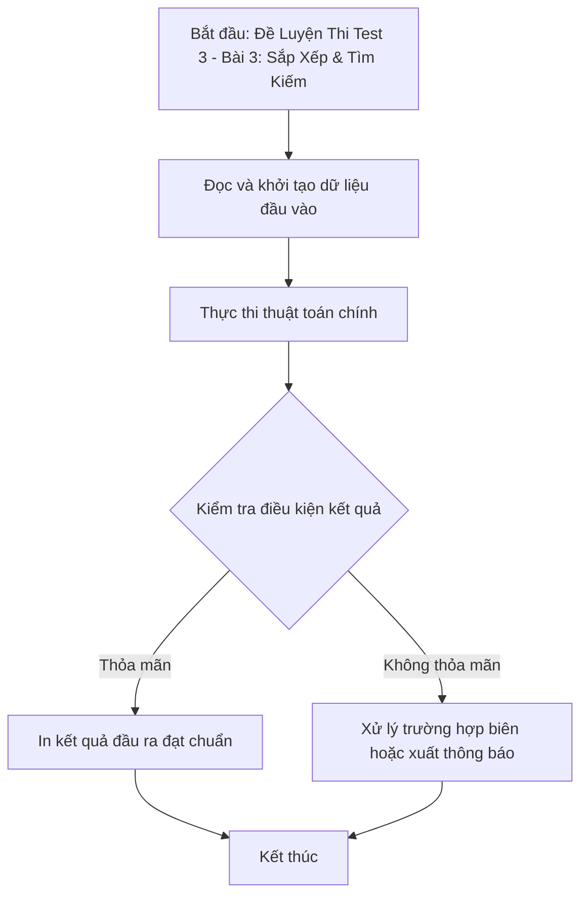

# Đề Luyện Thi Test 3 - Bài 3: Sắp Xếp & Tìm Kiếm

## 1. Thông tin tệp mã nguồn
- [`Bai3_test3.cpp`](./Bai3_test3.cpp)
- **Thư mục chuyên đề**: `DSA/13_Luyen_De_va_Tong_Hop/Bai3_test3/`
- **Ngôn ngữ**: C/C++ (Chuẩn C++11 trở lên)

## 2. Mục tiêu & Tóm tắt bài toán
Bài toán kết hợp sắp xếp và tìm kiếm nhị phân theo yêu cầu.

---

## 3. Ý tưởng & Phương pháp giải thuật
### Phương án tiếp cận:
std::sort và tìm kiếm nhị phân.

### Các bước thực hiện chi tiết:
1. Khởi tạo dữ liệu và đọc đầu vào theo định dạng bài toán.
2. Thực hiện thuật toán cốt lõi: std::sort và tìm kiếm nhị phân.
3. Cập nhật trạng thái và tính toán kết quả.
4. Xuất kết quả đầu ra màn hình.

---

## 4. Sơ đồ thuật toán (Mermaid Workflow)


---

## 5. Đánh giá độ phức tạp
- **Độ phức tạp thời gian (Time Complexity)**: `O(N log N)`
- **Độ phức tạp không gian (Space Complexity)**: `O(N)`

---

## 6. Input / Output mẫu & Giải thích

### Input mẫu:
```text
8 8
4 6 1 8 4 9 8 2
6 0 8 5 7 8 9 6
1 5 7 1 5 2 6 0
6 2 2 0 4 9 8 0
0 0 6 9 4 6 4 6
1 1 1 6 2 9 3 7
1 0 7 8 4 5 7 6
1 1 5 4 7 2 4 3
3
2 6 3 7
2 5 1 8
2 6 2 8
```

### Output mẫu:
```text
31
37
41
```

### Giải thích:
Truy vấn tổng các phần tử trong hình chữ nhật con trên ma trận 8x8 sử dụng mảng cộng dồn 2D (Prefix Sum 2D).

## 7. Hướng dẫn biên dịch & chạy thử
```bash
# Di chuyển vào thư mục bài toán
cd "DSA/13_Luyen_De_va_Tong_Hop/Bai3_test3"

# Biên dịch chương trình C++
g++ -std=c++11 -O2 "Bai3_test3.cpp" -o "Bai3_test3"

# Chạy chương trình
./"Bai3_test3"
```

> [!NOTE]
> Toàn bộ mã nguồn C++ gốc được bảo toàn nguyên vẹn 100% không qua chỉnh sửa.
