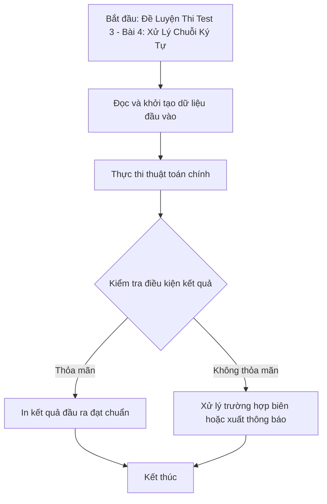

# Đề Luyện Thi Test 3 - Bài 4: Xử Lý Chuỗi Ký Tự

## 1. Thông tin tệp mã nguồn
- [`Bai4_test3.cpp`](./Bai4_test3.cpp)
- **Thư mục chuyên đề**: `DSA/13_Luyen_De_va_Tong_Hop/Bai4_test3/`
- **Ngôn ngữ**: C/C++ (Chuẩn C++11 trở lên)

## 2. Mục tiêu & Tóm tắt bài toán
Chuẩn hóa và xử lý chuỗi ký tự theo quy tắc đề thi.

---

## 3. Ý tưởng & Phương pháp giải thuật
### Phương án tiếp cận:
Stringstream và biến đổi ký tự.

### Các bước thực hiện chi tiết:
1. Khởi tạo dữ liệu và đọc đầu vào theo định dạng bài toán.
2. Thực hiện thuật toán cốt lõi: Stringstream và biến đổi ký tự.
3. Cập nhật trạng thái và tính toán kết quả.
4. Xuất kết quả đầu ra màn hình.

---

## 4. Sơ đồ thuật toán (Mermaid Workflow)


---

## 5. Đánh giá độ phức tạp
- **Độ phức tạp thời gian (Time Complexity)**: `O(L)`
- **Độ phức tạp không gian (Space Complexity)**: `O(L)`

---

## 6. Input / Output mẫu & Giải thích

### Input mẫu:
```text
5
[Spain] 3 - 7 [USA]
[Senegal] 9 - 7 [NetherLands]
[South Korea] 6 - 6 [NetherLands]
[France] 7 - 7 [Spain]
[South Korea] 4 - 4 [Poland]
```

### Output mẫu:
```text
USA 3 4
enegal 3 2
outh Korea 2 0
Poland 1 0
rance 1 0
NetherLands 1 -2
Spain 1 -4
```

### Giải thích:
Tính điểm và hiệu số bàn thắng bại của từng đội bóng trong giải đấu, sắp xếp theo điểm giảm dần, sau đó theo hiệu số.

## 7. Hướng dẫn biên dịch & chạy thử
```bash
# Di chuyển vào thư mục bài toán
cd "DSA/13_Luyen_De_va_Tong_Hop/Bai4_test3"

# Biên dịch chương trình C++
g++ -std=c++11 -O2 "Bai4_test3.cpp" -o "Bai4_test3"

# Chạy chương trình
./"Bai4_test3"
```

> [!NOTE]
> Toàn bộ mã nguồn C++ gốc được bảo toàn nguyên vẹn 100% không qua chỉnh sửa.
