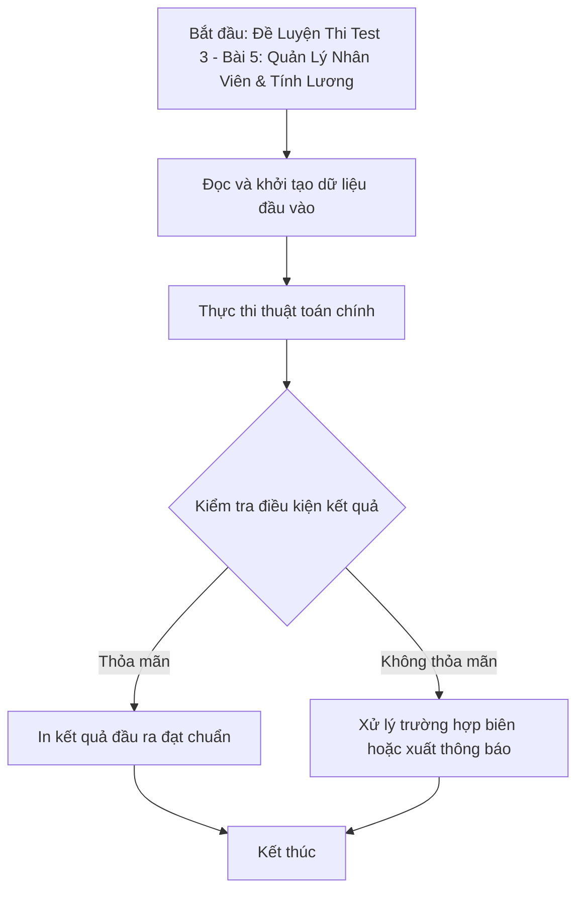

# Đề Luyện Thi Test 3 - Bài 5: Quản Lý Nhân Viên & Tính Lương

## 1. Thông tin tệp mã nguồn
- [`Bai5_test3.cpp`](./Bai5_test3.cpp)
- **Thư mục chuyên đề**: `DSA/13_Luyen_De_va_Tong_Hop/Bai5_test3/`
- **Ngôn ngữ**: C/C++ (Chuẩn C++11 trở lên)

## 2. Mục tiêu & Tóm tắt bài toán
Quản lý hồ sơ nhân viên, tính lương theo ngày công và sắp xếp giảm dần.

---

## 3. Ý tưởng & Phương pháp giải thuật
### Phương án tiếp cận:
Cấu trúc struct NhanVien và custom comparator.

### Các bước thực hiện chi tiết:
1. Khởi tạo dữ liệu và đọc đầu vào theo định dạng bài toán.
2. Thực hiện thuật toán cốt lõi: Cấu trúc struct NhanVien và custom comparator.
3. Cập nhật trạng thái và tính toán kết quả.
4. Xuất kết quả đầu ra màn hình.

---

## 4. Sơ đồ thuật toán (Mermaid Workflow)


---

## 5. Đánh giá độ phức tạp
- **Độ phức tạp thời gian (Time Complexity)**: `O(N log N)`
- **Độ phức tạp không gian (Space Complexity)**: `O(N)`

---

## 6. Input / Output mẫu & Giải thích

### Input mẫu:
```text
5
NV-0001
Vu Phuong Minh
16/10/1979
24
167000
NV-0002
Nguyen Hong Hai
23/11/1975
22
236000
GD-0003
Nguyen Hong Hai
14/6/1972
22
1000000
NV-0004
Vu Ngoc Tuan
9/11/1974
30
150000
NV-0005
Vu Van Hai
19/7/1972
23
216000
```

### Output mẫu:
```text
GD-0003 Nguyen Hong Hai Giam Doc 14/06/1972 22 1000000 23000000
NV-0004 Vu Ngoc Tuan Nhan Vien 09/11/1974 30 150000 5550000
NV-0002 Nguyen Hong Hai Nhan Vien 23/11/1975 22 236000 5428000
NV-0005 Vu Van Hai Nhan Vien 19/07/1972 23 216000 5184000
NV-0001 Vu Phuong Minh Nhan Vien 16/10/1979 24 167000 4175000
```

### Giải thích:
Tính thu nhập nhân viên = ngày công * lương cơ bản + phụ cấp chức vụ (Giám đốc: 1.000.000, Trưởng phòng: 800.000, Phó phòng: 500.000, Nhân viên: 200.000) và thưởng chuyên cần (nếu ngày công >= 25 thì thưởng 20%, >= 22 thưởng 10%), sắp xếp giảm dần theo thu nhập.

## 7. Hướng dẫn biên dịch & chạy thử
```bash
# Di chuyển vào thư mục bài toán
cd "DSA/13_Luyen_De_va_Tong_Hop/Bai5_test3"

# Biên dịch chương trình C++
g++ -std=c++11 -O2 "Bai5_test3.cpp" -o "Bai5_test3"

# Chạy chương trình
./"Bai5_test3"
```

> [!NOTE]
> Toàn bộ mã nguồn C++ gốc được bảo toàn nguyên vẹn 100% không qua chỉnh sửa.
