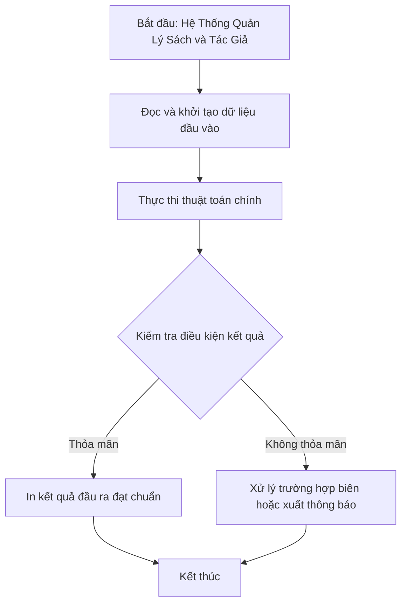

# Hệ Thống Quản Lý Sách và Tác Giả

## 1. Thông tin tệp mã nguồn
- [`Books_and_authors.cpp`](./Books_and_authors.cpp)
- **Thư mục chuyên đề**: `DSA/13_Luyen_De_va_Tong_Hop/Books_and_authors/`
- **Ngôn ngữ**: C/C++ (Chuẩn C++11 trở lên)

## 2. Mục tiêu & Tóm tắt bài toán
Quản lý danh sách sách: tên sách, giá bán, số lượng trang và tác giả.

---

## 3. Ý tưởng & Phương pháp giải thuật
### Phương án tiếp cận:
Struct Book, nạp chồng toán tử và sắp xếp theo giá tiền / trang sách.

### Các bước thực hiện chi tiết:
1. Khởi tạo dữ liệu và đọc đầu vào theo định dạng bài toán.
2. Thực hiện thuật toán cốt lõi: Struct Book, nạp chồng toán tử và sắp xếp theo giá tiền / trang sách.
3. Cập nhật trạng thái và tính toán kết quả.
4. Xuất kết quả đầu ra màn hình.

---

## 4. Sơ đồ thuật toán (Mermaid Workflow)


---

## 5. Đánh giá độ phức tạp
- **Độ phức tạp thời gian (Time Complexity)**: `O(N log N)`
- **Độ phức tạp không gian (Space Complexity)**: `O(N)`

---

## 6. Input / Output mẫu & Giải thích

### Input mẫu:
```text
4
A Brief History of time
700000
2137
1
Andrew Neiman
Andrew Neiman.author@gamil.com
Don Quixote
500000
2002
3
Thomas Che
Thomas Che.author@gmail.com
Happer Lee
Happer Lee.author@gmail.com
One Hundres Years of Solitude
700000
1920
2
Tom Cruise
Tom Cruise.author@gmail.com
```

### Output mẫu:
```text
-----------------------------------
Book information :
Name:
Price:2137
Quantity:1
Author information:
-----------------------------------
Book information :
Name:
Price:2137
Quantity:1
Author information:
-----------------------------------
Book information :
Name:
Price:2137
Quantity:1
Author information:
-----------------------------------
Book information :
Name:700000
Price:2137
Quantity:1
Author information:
```

### Giải thích:
Quản lý sách.

## 7. Hướng dẫn biên dịch & chạy thử
```bash
# Di chuyển vào thư mục bài toán
cd "DSA/13_Luyen_De_va_Tong_Hop/Books_and_authors"

# Biên dịch chương trình C++
g++ -std=c++11 -O2 "Books_and_authors.cpp" -o "Books_and_authors"

# Chạy chương trình
./"Books_and_authors"
```

> [!NOTE]
> Toàn bộ mã nguồn C++ gốc được bảo toàn nguyên vẹn 100% không qua chỉnh sửa.
