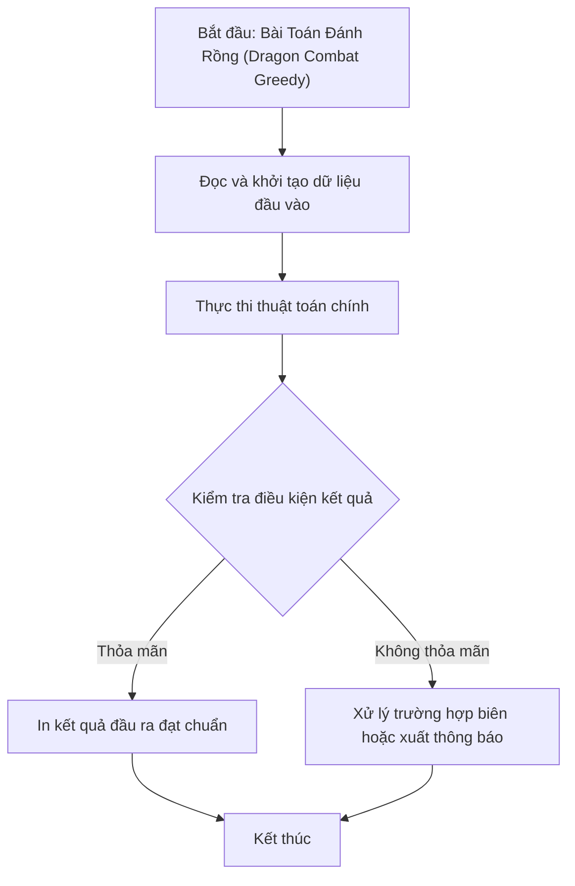

# Bài Toán Đánh Rồng (Dragon Combat Greedy)

## 1. Thông tin tệp mã nguồn
- [`Danh_rong.c++`](./Danh_rong.c++)
- **Thư mục chuyên đề**: `DSA/13_Luyen_De_va_Tong_Hop/Danh_rong/`
- **Ngôn ngữ**: C/C++ (Chuẩn C++11 trở lên)

## 2. Mục tiêu & Tóm tắt bài toán
Xác định hiệp sĩ có thể đánh bại tất cả các con rồng và tăng sức mạnh hay không.

---

## 3. Ý tưởng & Phương pháp giải thuật
### Phương án tiếp cận:
Sắp xếp rồng tăng dần theo sức mạnh (Greedy).

### Các bước thực hiện chi tiết:
1. Khởi tạo dữ liệu và đọc đầu vào theo định dạng bài toán.
2. Thực hiện thuật toán cốt lõi: Sắp xếp rồng tăng dần theo sức mạnh (Greedy).
3. Cập nhật trạng thái và tính toán kết quả.
4. Xuất kết quả đầu ra màn hình.

---

## 4. Sơ đồ thuật toán (Mermaid Workflow)


---

## 5. Đánh giá độ phức tạp
- **Độ phức tạp thời gian (Time Complexity)**: `O(N log N)`
- **Độ phức tạp không gian (Space Complexity)**: `O(N)`

---

## 6. Input / Output mẫu & Giải thích

### Input mẫu:
```text
2 2
1 99
100 0
```

### Output mẫu:
```text
Yes
```

### Giải thích:
Hiệp sĩ đánh bại tất cả rồng.

## 7. Hướng dẫn biên dịch & chạy thử
```bash
# Di chuyển vào thư mục bài toán
cd "DSA/13_Luyen_De_va_Tong_Hop/Danh_rong"

# Biên dịch chương trình C++
g++ -std=c++11 -O2 "Danh_rong.c++" -o "Danh_rong"

# Chạy chương trình
./"Danh_rong"
```

> [!NOTE]
> Toàn bộ mã nguồn C++ gốc được bảo toàn nguyên vẹn 100% không qua chỉnh sửa.
