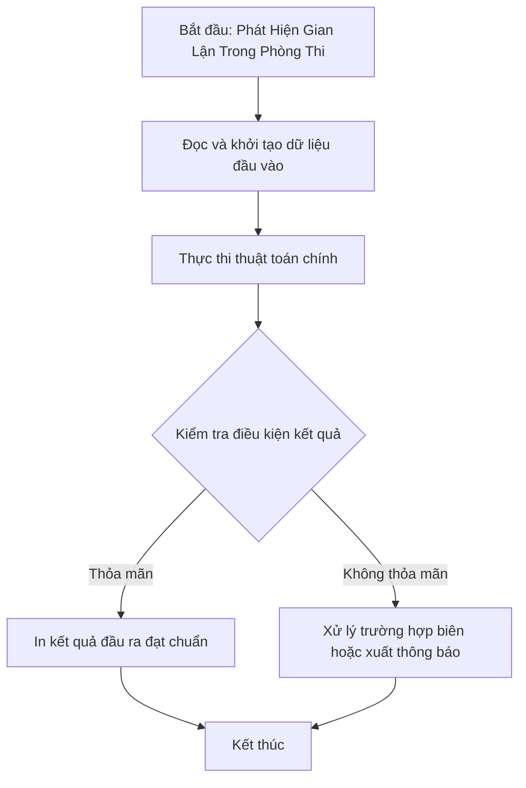

# Phát Hiện Gian Lận Trong Phòng Thi

## 1. Thông tin tệp mã nguồn
- [`Gian_lan.c++`](./Gian_lan.c++)
- **Thư mục chuyên đề**: `DSA/13_Luyen_De_va_Tong_Hop/Gian_lan/`
- **Ngôn ngữ**: C/C++ (Chuẩn C++11 trở lên)

## 2. Mục tiêu & Tóm tắt bài toán
Theo dõi lịch sử nộp bài và phát hiện sinh viên có hành vi gian lận.

---

## 3. Ý tưởng & Phương pháp giải thuật
### Phương án tiếp cận:
Map / Hash set lưu mã sinh viên và trạng thái bài nộp.

### Các bước thực hiện chi tiết:
1. Khởi tạo dữ liệu và đọc đầu vào theo định dạng bài toán.
2. Thực hiện thuật toán cốt lõi: Map / Hash set lưu mã sinh viên và trạng thái bài nộp.
3. Cập nhật trạng thái và tính toán kết quả.
4. Xuất kết quả đầu ra màn hình.

---

## 4. Sơ đồ thuật toán (Mermaid Workflow)


---

## 5. Đánh giá độ phức tạp
- **Độ phức tạp thời gian (Time Complexity)**: `O(N log N)`
- **Độ phức tạp không gian (Space Complexity)**: `O(N)`

---

## 6. Input / Output mẫu & Giải thích

### Input mẫu:
```text
5 5
SV0001 Pham Duc Tuan
SV0002 Pham Hong Trong Tam
SV0003 Nguyen Duc Trong Tam
SV0004 Luong Hong Trong Tam
SV0005 Pham Manh Hung
26/11/2022 19:27:24 SV0005 code.ptit.edu.vn
26/11/2022 19:15:24 SV0005 code.ptit.edu.vn
26/11/2022 19:19:56 SV0001 code.ptit.edu.vn
26/11/2022 19:56:10 SV0005 code.ptit.edu.vn
26/11/2022 19:35:45 SV0002 code.ptit.edu.vn
```

### Output mẫu:
```text
SV0001 Pham Duc Tuan V0002 Pham Hong Trong Tam V0003 Nguyen Duc Trong Tam V0004 Luong Hong Trong Tam V0005 Pham Manh Hung FAIL
```

### Giải thích:
Kiểm tra nhật ký nộp bài thi để phát hiện sinh viên truy cập địa chỉ ngoài quy định và gắn cờ gian lận (FAIL).

## 7. Hướng dẫn biên dịch & chạy thử
```bash
# Di chuyển vào thư mục bài toán
cd "DSA/13_Luyen_De_va_Tong_Hop/Gian_lan"

# Biên dịch chương trình C++
g++ -std=c++11 -O2 "Gian_lan.c++" -o "Gian_lan"

# Chạy chương trình
./"Gian_lan"
```

> [!NOTE]
> Toàn bộ mã nguồn C++ gốc được bảo toàn nguyên vẹn 100% không qua chỉnh sửa.
