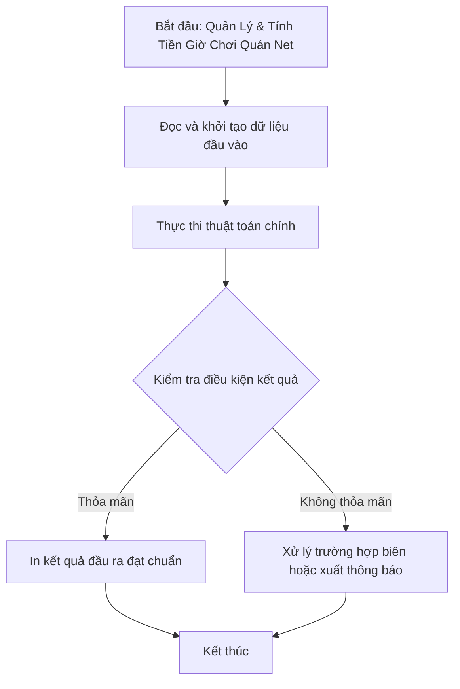

# Quản Lý & Tính Tiền Giờ Chơi Quán Net

## 1. Thông tin tệp mã nguồn
- [`Gio_quan_net.cpp`](./Gio_quan_net.cpp)
- **Thư mục chuyên đề**: `DSA/13_Luyen_De_va_Tong_Hop/Gio_quan_net/`
- **Ngôn ngữ**: C/C++ (Chuẩn C++11 trở lên)

## 2. Mục tiêu & Tóm tắt bài toán
Tính tổng thời gian chơi và sắp xếp khách hàng theo số giờ giảm dần.

---

## 3. Ý tưởng & Phương pháp giải thuật
### Phương án tiếp cận:
Quy đổi thời gian ra phút (hh*60 + mm), sắp xếp theo thời gian chơi.

### Các bước thực hiện chi tiết:
1. Khởi tạo dữ liệu và đọc đầu vào theo định dạng bài toán.
2. Thực hiện thuật toán cốt lõi: Quy đổi thời gian ra phút (hh*60 + mm), sắp xếp theo thời gian chơi.
3. Cập nhật trạng thái và tính toán kết quả.
4. Xuất kết quả đầu ra màn hình.

---

## 4. Sơ đồ thuật toán (Mermaid Workflow)


---

## 5. Đánh giá độ phức tạp
- **Độ phức tạp thời gian (Time Complexity)**: `O(N log N)`
- **Độ phức tạp không gian (Space Complexity)**: `O(N)`

---

## 6. Input / Output mẫu & Giải thích

### Input mẫu:
```text
5
anhtuanvip
123
Nguyen Van Tuan
05:18
07:06
chickenzero
124
Nguyen Van Phuc
05:38
14:19
anhhung123
matkhau
Nguyen manh Hung
06:58
14:18
loveyou
acb
Luong Van Manh
02:01
06:47
taikhoan123
matkhaumanh
Nguyen Thi Uyen
00:09
06:19
```

### Output mẫu:
```text
chickenzero 124 Nguyen Van Phuc 8 gio 41 phut
anhhung123 matkhau Nguyen manh Hung 7 gio 20 phut
taikhoan123 matkhaumanh Nguyen Thi Uyen 6 gio 10 phut
loveyou acb Luong Van Manh 4 gio 46 phut
anhtuanvip 123 Nguyen Van Tuan 1 gio 48 phut
```

### Giải thích:
Tính thời gian chơi của từng tài khoản từ giờ vào và giờ ra, sắp xếp theo thời gian chơi giảm dần (nếu bằng nhau thì xếp theo username tăng dần).

## 7. Hướng dẫn biên dịch & chạy thử
```bash
# Di chuyển vào thư mục bài toán
cd "DSA/13_Luyen_De_va_Tong_Hop/Gio_quan_net"

# Biên dịch chương trình C++
g++ -std=c++11 -O2 "Gio_quan_net.cpp" -o "Gio_quan_net"

# Chạy chương trình
./"Gio_quan_net"
```

> [!NOTE]
> Toàn bộ mã nguồn C++ gốc được bảo toàn nguyên vẹn 100% không qua chỉnh sửa.
