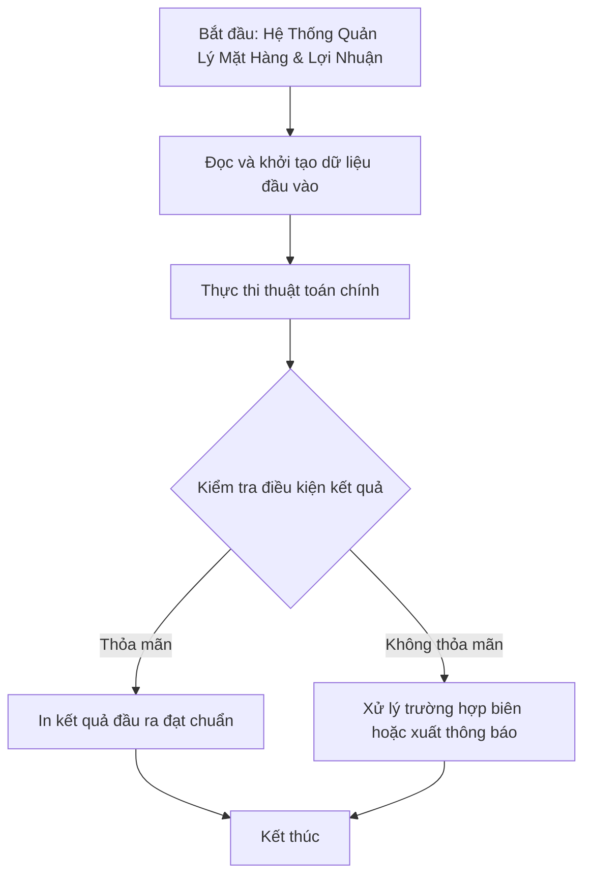

# Hệ Thống Quản Lý Mặt Hàng & Lợi Nhuận

## 1. Thông tin tệp mã nguồn
- [`Mat_hang.c++`](./Mat_hang.c++)
- **Thư mục chuyên đề**: `DSA/13_Luyen_De_va_Tong_Hop/Mat_hang/`
- **Ngôn ngữ**: C/C++ (Chuẩn C++11 trở lên)

## 2. Mục tiêu & Tóm tắt bài toán
Quản lý mặt hàng, tính tiền lãi (giá bán - giá mua) và sắp xếp giảm dần.

---

## 3. Ý tưởng & Phương pháp giải thuật
### Phương án tiếp cận:
Struct MatHang, sinh mã tự động MH001, tính lợi nhuận.

### Các bước thực hiện chi tiết:
1. Khởi tạo dữ liệu và đọc đầu vào theo định dạng bài toán.
2. Thực hiện thuật toán cốt lõi: Struct MatHang, sinh mã tự động MH001, tính lợi nhuận.
3. Cập nhật trạng thái và tính toán kết quả.
4. Xuất kết quả đầu ra màn hình.

---

## 4. Sơ đồ thuật toán (Mermaid Workflow)


---

## 5. Đánh giá độ phức tạp
- **Độ phức tạp thời gian (Time Complexity)**: `O(N log N)`
- **Độ phức tạp không gian (Space Complexity)**: `O(N)`

---

## 6. Input / Output mẫu & Giải thích

### Input mẫu:
```text
7
May giat
Philips
Cai
831000 1196000
Noi com dien
Sanyo
Cai
499000 676000
Noi com dien
SHARP
Cai
759000 937000
May lanh
SANTO
Cai
10000 105000
May giat
SATO
Cai
259000 413000
Ti vi
SHARP
Cai
510000 561000
May lanh
Sunhouse
Cai
163000 532000
```

### Output mẫu:
```text
ML0002 May lanh Sunhouse Cai 163000 532000
MG0001 May giat Philips Cai 831000 1196000
NCD0002 Noi com dien SHARP Cai 759000 937000
NCD0001 Noi com dien Sanyo Cai 499000 676000
MG0002 May giat SATO Cai 259000 413000
ML0001 May lanh SANTO Cai 10000 105000
TV0001 Ti vi SHARP Cai 510000 561000
```

### Giải thích:
Quản lý mặt hàng, tự động sinh mã sản phẩm và sắp xếp giảm dần theo lợi nhuận (giá bán - giá mua).

## 7. Hướng dẫn biên dịch & chạy thử
```bash
# Di chuyển vào thư mục bài toán
cd "DSA/13_Luyen_De_va_Tong_Hop/Mat_hang"

# Biên dịch chương trình C++
g++ -std=c++11 -O2 "Mat_hang.c++" -o "Mat_hang"

# Chạy chương trình
./"Mat_hang"
```

> [!NOTE]
> Toàn bộ mã nguồn C++ gốc được bảo toàn nguyên vẹn 100% không qua chỉnh sửa.
