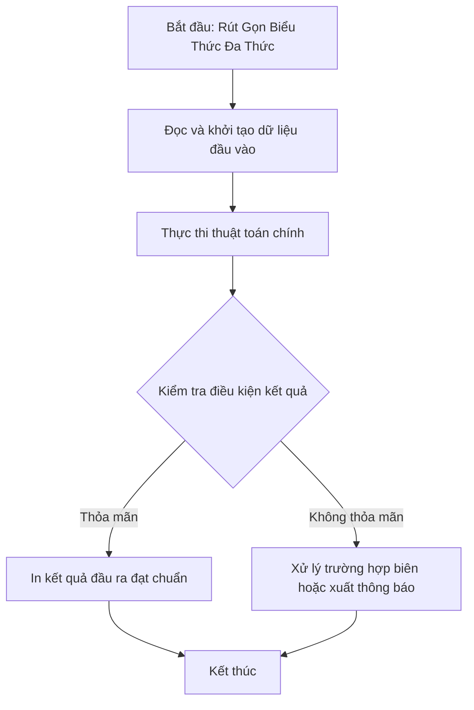

# Rút Gọn Biểu Thức Đa Thức

## 1. Thông tin tệp mã nguồn
- [`Rut_gon_da_thuc.cpp`](./Rut_gon_da_thuc.cpp)
- **Thư mục chuyên đề**: `DSA/13_Luyen_De_va_Tong_Hop/Rut_gon_da_thuc/`
- **Ngôn ngữ**: C/C++ (Chuẩn C++11 trở lên)

## 2. Mục tiêu & Tóm tắt bài toán
Cộng các đơn thức cùng số mũ và in đa thức rút gọn theo số mũ giảm dần.

---

## 3. Ý tưởng & Phương pháp giải thuật
### Phương án tiếp cận:
Sử dụng std::map<int, int, greater<int>> lưu hệ số theo số mũ.

### Các bước thực hiện chi tiết:
1. Khởi tạo dữ liệu và đọc đầu vào theo định dạng bài toán.
2. Thực hiện thuật toán cốt lõi: Sử dụng std::map<int, int, greater<int>> lưu hệ số theo số mũ.
3. Cập nhật trạng thái và tính toán kết quả.
4. Xuất kết quả đầu ra màn hình.

---

## 4. Sơ đồ thuật toán (Mermaid Workflow)


---

## 5. Đánh giá độ phức tạp
- **Độ phức tạp thời gian (Time Complexity)**: `O(L log K)`
- **Độ phức tạp không gian (Space Complexity)**: `O(K)`

---

## 6. Input / Output mẫu & Giải thích

### Input mẫu:
```text
1
4x^2+1x^0+5x^2+1x^1+4x^2+5x^3+2x^3+2x^4+3x^4
```

### Output mẫu:
```text
1x^0 + 1x^1 + 13x^2 + 7x^3 + 5x^4
```

### Giải thích:
Cộng dồn hệ số các đơn thức cùng số mũ: x^0 có hệ số 1; x^1 có hệ số 1; x^2 có hệ số 4+5+4=13; x^3 có 5+2=7; x^4 có 2+3=5.

## 7. Hướng dẫn biên dịch & chạy thử
```bash
# Di chuyển vào thư mục bài toán
cd "DSA/13_Luyen_De_va_Tong_Hop/Rut_gon_da_thuc"

# Biên dịch chương trình C++
g++ -std=c++11 -O2 "Rut_gon_da_thuc.cpp" -o "Rut_gon_da_thuc"

# Chạy chương trình
./"Rut_gon_da_thuc"
```

> [!NOTE]
> Toàn bộ mã nguồn C++ gốc được bảo toàn nguyên vẹn 100% không qua chỉnh sửa.
