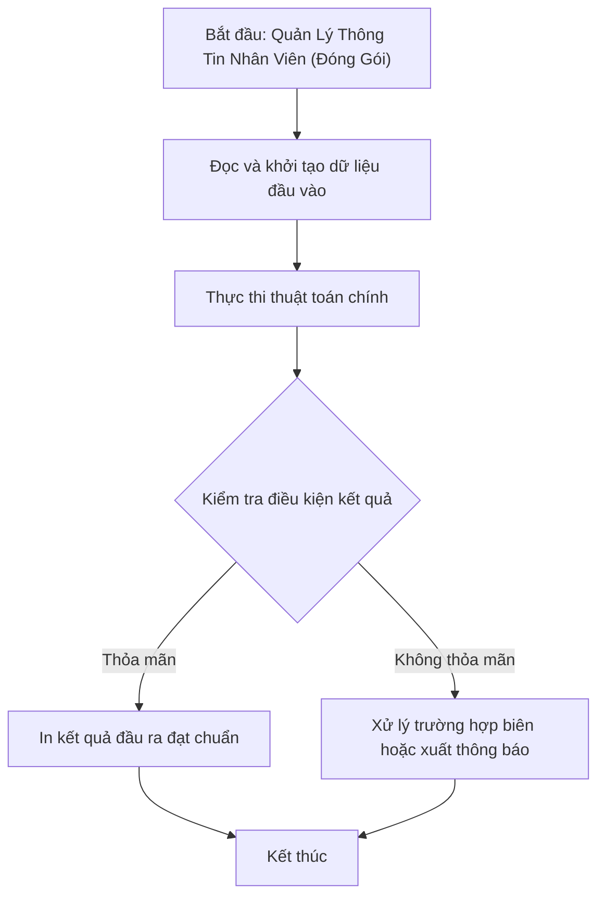

# Quản Lý Thông Tin Nhân Viên (Đóng Gói)

## 1. Thông tin tệp mã nguồn
- [`BT_TDG_thongtinnv.cpp`](./BT_TDG_thongtinnv.cpp)
- **Thư mục chuyên đề**: `DSA/14_Lap_Trinh_Huong_Doi_Tuong_OOP/BT_TDG_thongtinnv/`
- **Ngôn ngữ**: C/C++ (Chuẩn C++11 trở lên)

## 2. Mục tiêu & Tóm tắt bài toán
Xây dựng lớp NhanVien đóng gói thông tin cá nhân và tiền lương.

---

## 3. Ý tưởng & Phương pháp giải thuật
### Phương án tiếp cận:
Getter, setter và constructor đầy đủ.

### Các bước thực hiện chi tiết:
1. Khởi tạo dữ liệu và đọc đầu vào theo định dạng bài toán.
2. Thực hiện thuật toán cốt lõi: Getter, setter và constructor đầy đủ.
3. Cập nhật trạng thái và tính toán kết quả.
4. Xuất kết quả đầu ra màn hình.

---

## 4. Sơ đồ thuật toán (Mermaid Workflow)


---

## 5. Đánh giá độ phức tạp
- **Độ phức tạp thời gian (Time Complexity)**: `O(1)`
- **Độ phức tạp không gian (Space Complexity)**: `O(1)`

---

## 6. Input / Output mẫu & Giải thích

### Input mẫu:
```text
1
Nguyen Van A
Nam
01/01/1995
Ha Noi
0123456789
00001
```

### Output mẫu:
```text
Thong tin nhan vien:
00001 Nguyen Van A Nam 01/01/1995 Ha Noi 0123456789
```

### Giải thích:
Đóng gói đối tượng Nhanvien và nạp chồng toán tử nhập xuất >> và <<.

## 7. Hướng dẫn biên dịch & chạy thử
```bash
# Di chuyển vào thư mục bài toán
cd "DSA/14_Lap_Trinh_Huong_Doi_Tuong_OOP/BT_TDG_thongtinnv"

# Biên dịch chương trình C++
g++ -std=c++11 -O2 "BT_TDG_thongtinnv.cpp" -o "BT_TDG_thongtinnv"

# Chạy chương trình
./"BT_TDG_thongtinnv"
```

> [!NOTE]
> Toàn bộ mã nguồn C++ gốc được bảo toàn nguyên vẹn 100% không qua chỉnh sửa.
