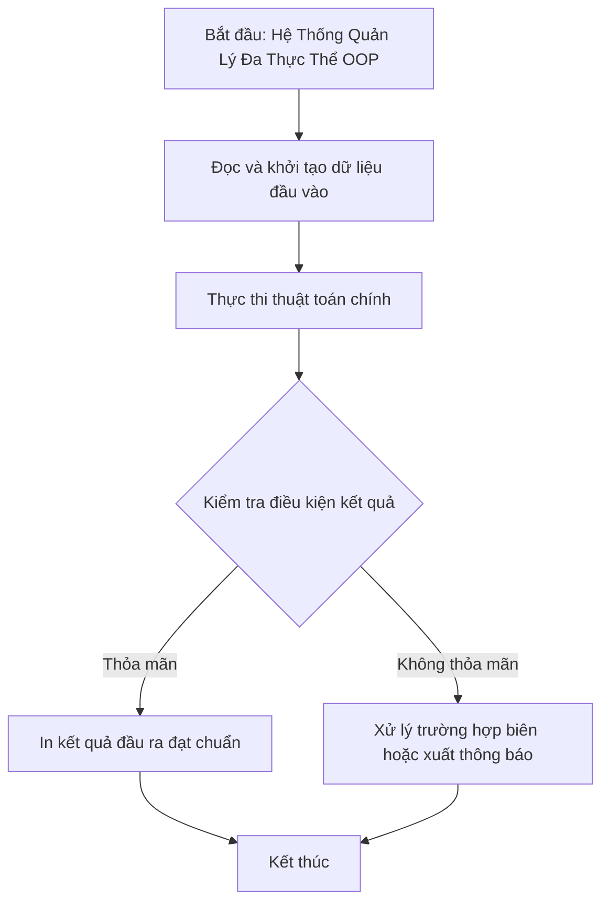

# Hệ Thống Quản Lý Đa Thực Thể OOP

## 1. Thông tin tệp mã nguồn
- [`Quanli.cpp`](./Quanli.cpp)
- [`main.cpp`](./main.cpp)
- [`main1.cpp`](./main1.cpp)
- [`main2.cpp`](./main2.cpp)
- [`thu.cpp`](./thu.cpp)
- **Thư mục chuyên đề**: `DSA/14_Lap_Trinh_Huong_Doi_Tuong_OOP/Chuong_Trinh_Quan_Ly/`
- **Ngôn ngữ**: C/C++ (Chuẩn C++11 trở lên)

## 2. Mục tiêu & Tóm tắt bài toán
Hệ thống chương trình quản lý thông tin đối tượng tổng hợp (main.cpp kết hợp SinhVien & Nguoi).

---

## 3. Ý tưởng & Phương pháp giải thuật
### Phương án tiếp cận:
Khởi tạo thực thể SinhVien, hiển thị bảng danh sách định dạng cột đẹp mắt với thư viện iomanip.

### Các bước thực hiện chi tiết:
1. Khởi tạo dữ liệu và đọc đầu vào theo định dạng bài toán.
2. Thực hiện thuật toán cốt lõi: Lập trình hướng đối tượng với các lớp thực thể.
3. Cập nhật trạng thái và tính toán kết quả.
4. Xuất kết quả đầu ra màn hình.

---

## 4. Sơ đồ thuật toán (Mermaid Workflow)


---

## 5. Đánh giá độ phức tạp
- **Độ phức tạp thời gian (Time Complexity)**: `O(N log N)`
- **Độ phức tạp không gian (Space Complexity)**: `O(N)`

---

## 6. Input / Output mẫu & Giải thích

### Input mẫu:
```text
Dữ liệu thiết lập trong main.cpp:
Ten: Tinh, Tuoi: 18, Gioi Tinh: Nam, ID: ABC123, Lop: 23T1, Diem: 10
```

### Output mẫu:
```text
Ham tao class Nguoi duoc goi!:
Ham to class SinhVien da duoc tao!
--------------------------------
Thong tin sinh vien:
Ten       Tuoi      Gioi Tinh      ID        Lop            Diem      
Tinh      18        Nam            ABC123    23T1           10.00
--------------------------------
Ham huy class SinhVien da duoc tao!
Ham huy class Nguoi duoc tao:!
```

### Giải thích:
Hàm main khởi tạo sinh viên và hiển thị tiêu đề cùng dữ liệu được căn lề chuẩn mực.

## 7. Hướng dẫn biên dịch & chạy thử
```bash
# Di chuyển vào thư mục bài toán
cd "DSA/14_Lap_Trinh_Huong_Doi_Tuong_OOP/Chuong_Trinh_Quan_Ly"

# Biên dịch chương trình C++
g++ -std=c++11 -O2 "Quanli.cpp" -o "Quanli"

# Chạy chương trình
./"Quanli"
```

> [!NOTE]
> Toàn bộ mã nguồn C++ gốc được bảo toàn nguyên vẹn 100% không qua chỉnh sửa.
