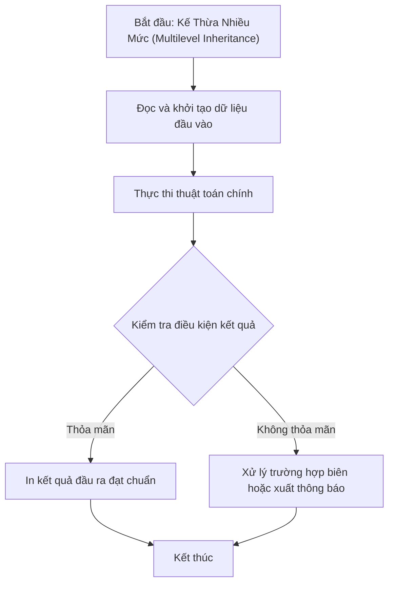

# Kế Thừa Nhiều Mức (Multilevel Inheritance)

## 1. Thông tin tệp mã nguồn
- [`Ke_thua_nhieu_muc.cpp`](./Ke_thua_nhieu_muc.cpp)
- **Thư mục chuyên đề**: `DSA/14_Lap_Trinh_Huong_Doi_Tuong_OOP/Ke_thua_nhieu_muc/`
- **Ngôn ngữ**: C/C++ (Chuẩn C++11 trở lên)

## 2. Mục tiêu & Tóm tắt bài toán
Minh họa Đa kế thừa (Multiple Inheritance) trong C++.

---

## 3. Ý tưởng & Phương pháp giải thuật
### Phương án tiếp cận:
Lớp D kế thừa đồng thời từ 3 lớp cha A, B, C; kiểm tra thứ tự gọi constructor và phân giải phương thức C::xinchao().

### Các bước thực hiện chi tiết:
1. Khởi tạo dữ liệu và đọc đầu vào theo định dạng bài toán.
2. Thực hiện thuật toán cốt lõi: Kế thừa chuyển tiếp đa tầng.
3. Cập nhật trạng thái và tính toán kết quả.
4. Xuất kết quả đầu ra màn hình.

---

## 4. Sơ đồ thuật toán (Mermaid Workflow)


---

## 5. Đánh giá độ phức tạp
- **Độ phức tạp thời gian (Time Complexity)**: `O(1)`
- **Độ phức tạp không gian (Space Complexity)**: `O(1)`

---

## 6. Input / Output mẫu & Giải thích

### Input mẫu:
```text
Không yêu cầu tham số đầu vào (khởi tạo đối tượng D trong main)
```

### Output mẫu:
```text
Ham constructer duoc tao A!
Ham constructer duoc tao B!
Ham constructer duoc tao C!
Ham D duoc ke thua tu A,B,C!
Xin chao C!
Ham destructer duoc tao C!
Ham destructer duoc tao B!
Ham destructer duoc tao A!
```

### Giải thích:
Khi đối tượng D được khởi tạo, constructor của các lớp cha A, B, C lần lượt được gọi trước, tiếp đến constructor của D. Gọi hàm C::xinchao() qua toán tử phạm vi ::. Khi kết thúc chương trình, hàm hủy destructer được gọi theo thứ tự ngược lại.

## 7. Hướng dẫn biên dịch & chạy thử
```bash
# Di chuyển vào thư mục bài toán
cd "DSA/14_Lap_Trinh_Huong_Doi_Tuong_OOP/Ke_thua_nhieu_muc"

# Biên dịch chương trình C++
g++ -std=c++11 -O2 "Ke_thua_nhieu_muc.cpp" -o "Ke_thua_nhieu_muc"

# Chạy chương trình
./"Ke_thua_nhieu_muc"
```

> [!NOTE]
> Toàn bộ mã nguồn C++ gốc được bảo toàn nguyên vẹn 100% không qua chỉnh sửa.
