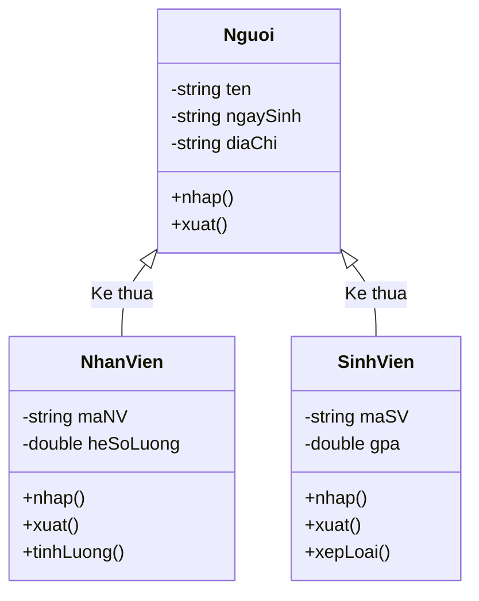

# Cài Đặt Lớp Bảo Vệ (BaoVe)

## 1. Thông tin tệp mã nguồn
- [`baove.cpp`](./baove.cpp)
- [`baove.h`](./baove.h)
- **Thư mục chuyên đề**: `DSA/14_Lap_Trinh_Huong_Doi_Tuong_OOP/Lop_BaoVe/`
- **Ngôn ngữ**: C/C++ (Chuẩn C++11 trở lên)

## 2. Mục tiêu & Tóm tắt bài toán
Lớp BaoVe kế thừa từ NhanVien, bổ sung vị trí trực và thời hạn.

---

## 3. Ý tưởng & Phương pháp giải thuật
### Phương án tiếp cận:
Kế thừa thông tin nhân sự, quản lý thêm khu vực trực (local) và thời hạn làm việc (duration).

### Các bước thực hiện chi tiết:
1. Khởi tạo dữ liệu và đọc đầu vào theo định dạng bài toán.
2. Thực hiện thuật toán cốt lõi: Kế thừa và tính đóng gói.
3. Cập nhật trạng thái và tính toán kết quả.
4. Xuất kết quả đầu ra màn hình.

---

## 4. Sơ đồ thuật toán (Mermaid Workflow)


---

## 5. Đánh giá độ phức tạp
- **Độ phức tạp thời gian (Time Complexity)**: `O(1)`
- **Độ phức tạp không gian (Space Complexity)**: `O(1)`

---

## 6. Input / Output mẫu & Giải thích

### Input mẫu:
```text
Khởi tạo đối tượng: int l = 8000000; baove bv("45", &l, "Bao Ve A", "Nam", "Cong Chinh", "Ca Dem"); bv.display();
```

### Output mẫu:
```text
Ham tao duoc tao
Ham tao da duoc goi!
Bao Ve A
Nam
45
8000000
vi tri:Cong Chinh
thoi han:Ca Dem
Ham huy da duoc tao!
Ham huy da duoc tao
```

### Giải thích:
Lớp bảo vệ gọi constructor nhân viên trước, sau đó thiết lập vị trí Cổng Chính và ca làm việc Ca Đêm.

## 7. Hướng dẫn biên dịch & chạy thử
```bash
# Di chuyển vào thư mục bài toán
cd "DSA/14_Lap_Trinh_Huong_Doi_Tuong_OOP/Lop_BaoVe"

# Biên dịch chương trình C++
g++ -std=c++11 -O2 "baove.cpp" -o "baove"

# Chạy chương trình
./"baove"
```

> [!NOTE]
> Toàn bộ mã nguồn C++ gốc được bảo toàn nguyên vẹn 100% không qua chỉnh sửa.
