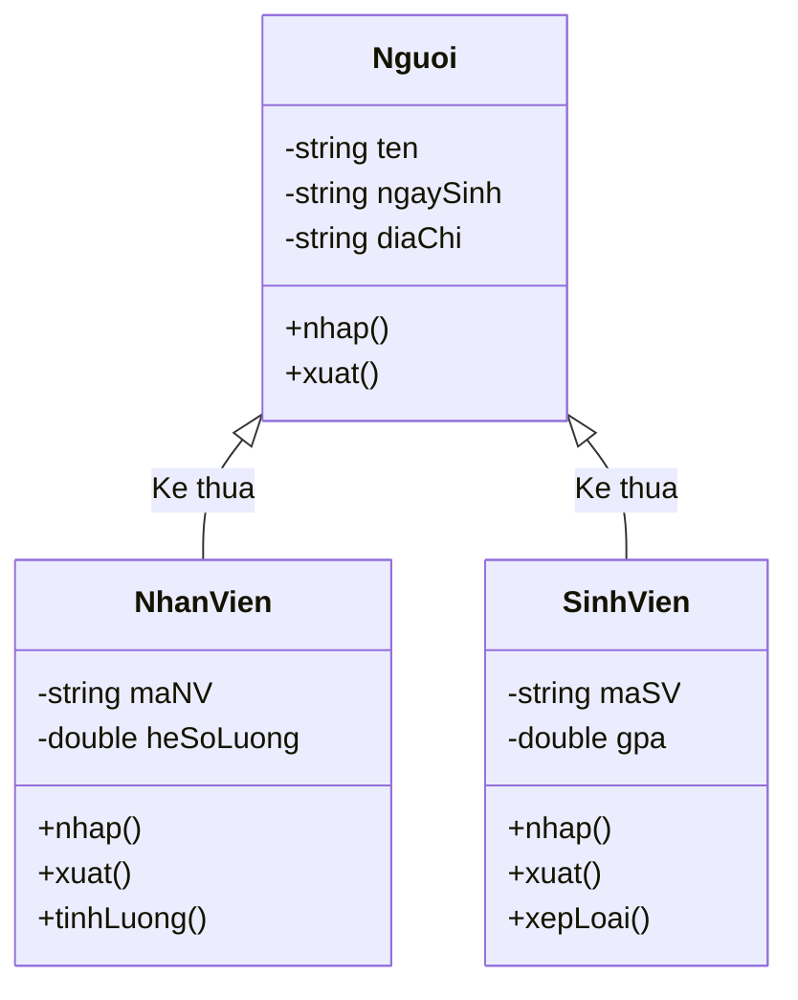

# Cài Đặt Lớp Người (Nguoi)

## 1. Thông tin tệp mã nguồn
- [`nguoi.cpp`](./nguoi.cpp)
- [`nguoi.h`](./nguoi.h)
- **Thư mục chuyên đề**: `DSA/14_Lap_Trinh_Huong_Doi_Tuong_OOP/Lop_Nguoi/`
- **Ngôn ngữ**: C/C++ (Chuẩn C++11 trở lên)

## 2. Mục tiêu & Tóm tắt bài toán
Lớp Nguoi cơ sở trong mô hình quản lý thực thể OOP.

---

## 3. Ý tưởng & Phương pháp giải thuật
### Phương án tiếp cận:
Đóng gói các thuộc tính Họ tên (name), Tuổi (age), Giới tính (sex) kèm constructor, getter/setter và phương thức display().

### Các bước thực hiện chi tiết:
1. Khởi tạo dữ liệu và đọc đầu vào theo định dạng bài toán.
2. Thực hiện thuật toán cốt lõi: Lớp cha trong mô hình phân cấp kế thừa.
3. Cập nhật trạng thái và tính toán kết quả.
4. Xuất kết quả đầu ra màn hình.

---

## 4. Sơ đồ thuật toán (Mermaid Workflow)


---

## 5. Đánh giá độ phức tạp
- **Độ phức tạp thời gian (Time Complexity)**: `O(1)`
- **Độ phức tạp không gian (Space Complexity)**: `O(1)`

---

## 6. Input / Output mẫu & Giải thích

### Input mẫu:
```text
Khởi tạo đối tượng: Nguoi n("Tinh", "18", "Nam");
```

### Output mẫu:
```text
Ham tao class Nguoi duoc goi!:
Tinh      18        Nam            
Ham huy class Nguoi duoc tao:!
```

### Giải thích:
Constructor gán tên, tuổi, giới tính và in thông báo khởi tạo. Hàm display() xuất thông tin dưới dạng bảng sử dụng setw, và hàm hủy in thông báo khi giải phóng đối tượng.

## 7. Hướng dẫn biên dịch & chạy thử
```bash
# Di chuyển vào thư mục bài toán
cd "DSA/14_Lap_Trinh_Huong_Doi_Tuong_OOP/Lop_Nguoi"

# Biên dịch chương trình C++
g++ -std=c++11 -O2 "nguoi.cpp" -o "nguoi"

# Chạy chương trình
./"nguoi"
```

> [!NOTE]
> Toàn bộ mã nguồn C++ gốc được bảo toàn nguyên vẹn 100% không qua chỉnh sửa.
