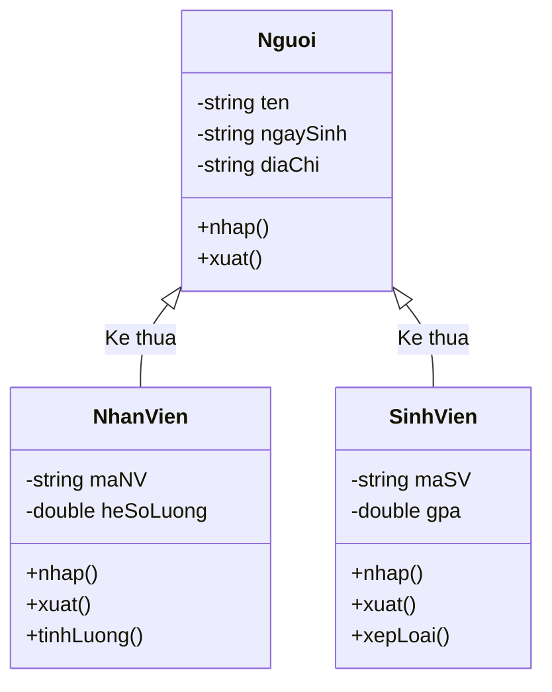

# Cài Đặt Lớp Nhân Viên (NhanVien)

## 1. Thông tin tệp mã nguồn
- [`nhanvien.cpp`](./nhanvien.cpp)
- [`nhanvien.h`](./nhanvien.h)
- **Thư mục chuyên đề**: `DSA/14_Lap_Trinh_Huong_Doi_Tuong_OOP/Lop_NhanVien/`
- **Ngôn ngữ**: C/C++ (Chuẩn C++11 trở lên)

## 2. Mục tiêu & Tóm tắt bài toán
Lớp NhanVien lưu trữ thông tin nhân sự và mức lương.

---

## 3. Ý tưởng & Phương pháp giải thuật
### Phương án tiếp cận:
Đóng gói tên, giới tính, tuổi và con trỏ lương (salary), cung cấp hàm display() hiển thị thông tin.

### Các bước thực hiện chi tiết:
1. Khởi tạo dữ liệu và đọc đầu vào theo định dạng bài toán.
2. Thực hiện thuật toán cốt lõi: Kế thừa đơn và nạp chồng toán tử.
3. Cập nhật trạng thái và tính toán kết quả.
4. Xuất kết quả đầu ra màn hình.

---

## 4. Sơ đồ thuật toán (Mermaid Workflow)


---

## 5. Đánh giá độ phức tạp
- **Độ phức tạp thời gian (Time Complexity)**: `O(1)`
- **Độ phức tạp không gian (Space Complexity)**: `O(1)`

---

## 6. Input / Output mẫu & Giải thích

### Input mẫu:
```text
Khởi tạo đối tượng: int luong = 15000000; nhanvien nv("Quach Tinh", "Nam", "25", &luong); nv.display();
```

### Output mẫu:
```text
Ham tao duoc tao
Quach Tinh
Nam
25
15000000
Ham huy da duoc tao
```

### Giải thích:
Khởi tạo nhân viên với lương 15.000.000đ, hiển thị từng thuộc tính ra màn hình.

## 7. Hướng dẫn biên dịch & chạy thử
```bash
# Di chuyển vào thư mục bài toán
cd "DSA/14_Lap_Trinh_Huong_Doi_Tuong_OOP/Lop_NhanVien"

# Biên dịch chương trình C++
g++ -std=c++11 -O2 "nhanvien.cpp" -o "nhanvien"

# Chạy chương trình
./"nhanvien"
```

> [!NOTE]
> Toàn bộ mã nguồn C++ gốc được bảo toàn nguyên vẹn 100% không qua chỉnh sửa.
