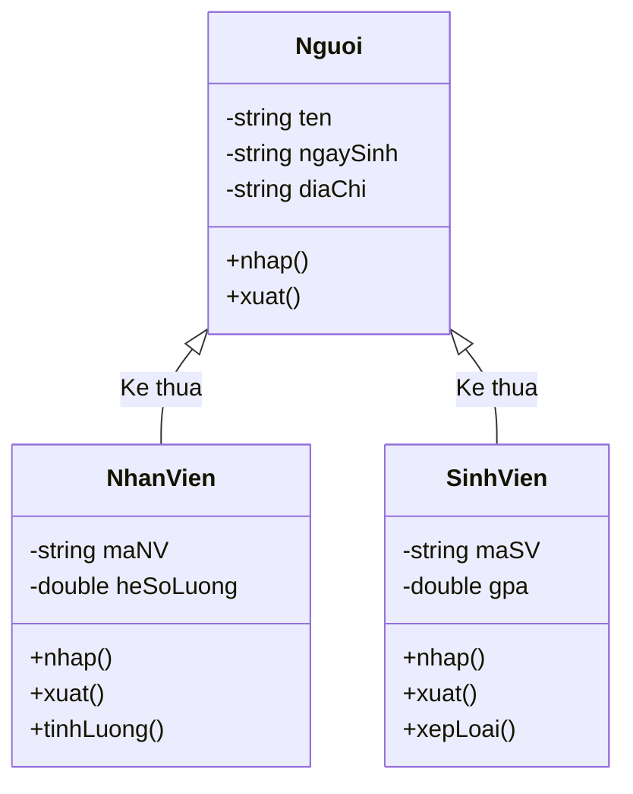

# Cài Đặt Lớp Sinh Viên (SinhVien)

## 1. Thông tin tệp mã nguồn
- [`sinhvien.cpp`](./sinhvien.cpp)
- [`sinhvien.h`](./sinhvien.h)
- **Thư mục chuyên đề**: `DSA/14_Lap_Trinh_Huong_Doi_Tuong_OOP/Lop_SinhVien/`
- **Ngôn ngữ**: C/C++ (Chuẩn C++11 trở lên)

## 2. Mục tiêu & Tóm tắt bài toán
Lớp SinhVien kế thừa từ lớp cơ sở Nguoi.

---

## 3. Ý tưởng & Phương pháp giải thuật
### Phương án tiếp cận:
Bổ sung thêm điểm (mark), xếp loại (grand), mã số (ID) và nạp chồng/mở rộng phương thức display().

### Các bước thực hiện chi tiết:
1. Khởi tạo dữ liệu và đọc đầu vào theo định dạng bài toán.
2. Thực hiện thuật toán cốt lõi: Kế thừa Nguoi và tính đóng gói.
3. Cập nhật trạng thái và tính toán kết quả.
4. Xuất kết quả đầu ra màn hình.

---

## 4. Sơ đồ thuật toán (Mermaid Workflow)


---

## 5. Đánh giá độ phức tạp
- **Độ phức tạp thời gian (Time Complexity)**: `O(1)`
- **Độ phức tạp không gian (Space Complexity)**: `O(1)`

---

## 6. Input / Output mẫu & Giải thích

### Input mẫu:
```text
Khởi tạo đối tượng: SinhVien sv("Tinh", "18", "Nam", 10.0, "23T1", "ABC123");
```

### Output mẫu:
```text
Ham tao class Nguoi duoc goi!:
Ham to class SinhVien da duoc tao!
--------------------------------
Tinh      18        Nam            ABC123    23T1           10.00
--------------------------------
Ham huy class SinhVien da duoc tao!
Ham huy class Nguoi duoc tao:!
```

### Giải thích:
SinhVien kế thừa tên, tuổi, giới tính từ Nguoi, đồng thời quản lý thêm mã sinh viên ABC123, lớp 23T1 và điểm 10.00.

## 7. Hướng dẫn biên dịch & chạy thử
```bash
# Di chuyển vào thư mục bài toán
cd "DSA/14_Lap_Trinh_Huong_Doi_Tuong_OOP/Lop_SinhVien"

# Biên dịch chương trình C++
g++ -std=c++11 -O2 "sinhvien.cpp" -o "sinhvien"

# Chạy chương trình
./"sinhvien"
```

> [!NOTE]
> Toàn bộ mã nguồn C++ gốc được bảo toàn nguyên vẹn 100% không qua chỉnh sửa.
