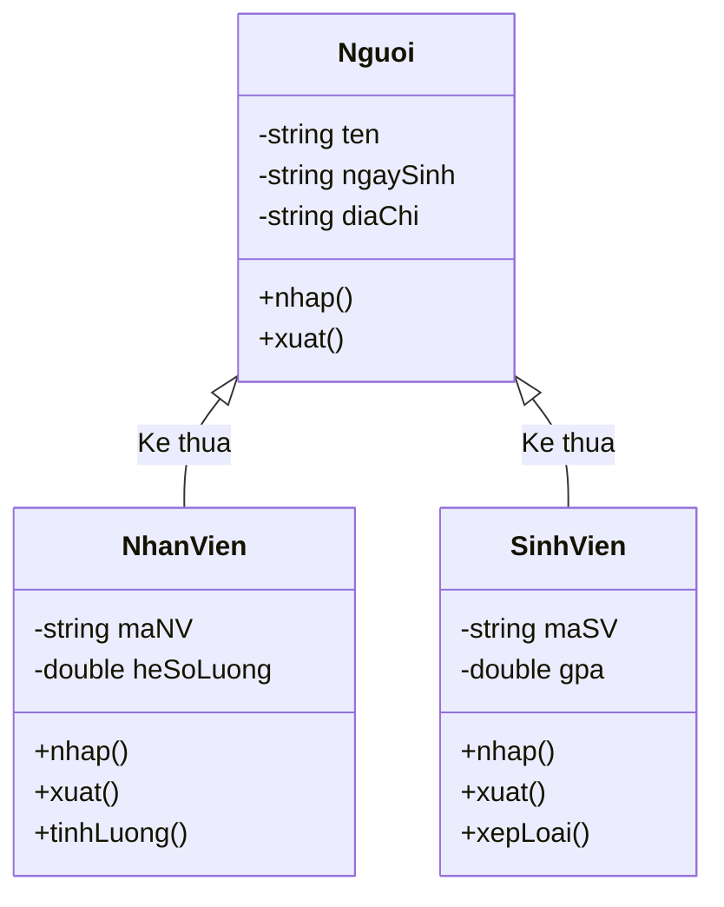

# Cài Đặt Lớp Thời Gian (Time)

## 1. Thông tin tệp mã nguồn
- [`time.cpp`](./time.cpp)
- [`time.h`](./time.h)
- **Thư mục chuyên đề**: `DSA/14_Lap_Trinh_Huong_Doi_Tuong_OOP/Lop_Time/`
- **Ngôn ngữ**: C/C++ (Chuẩn C++11 trở lên)

## 2. Mục tiêu & Tóm tắt bài toán
Lớp Time đóng gói giờ, phút, giây và nạp chồng toán tử.

---

## 3. Ý tưởng & Phương pháp giải thuật
### Phương án tiếp cận:
Quản lý thời gian, chuẩn hóa số giây, phút, giờ và cung cấp các hàm hiển thị định dạng chuẩn hh:mm:ss.

### Các bước thực hiện chi tiết:
1. Khởi tạo dữ liệu và đọc đầu vào theo định dạng bài toán.
2. Thực hiện thuật toán cốt lõi: Đóng gói thời gian và nạp chồng toán tử.
3. Cập nhật trạng thái và tính toán kết quả.
4. Xuất kết quả đầu ra màn hình.

---

## 4. Sơ đồ thuật toán (Mermaid Workflow)


---

## 5. Đánh giá độ phức tạp
- **Độ phức tạp thời gian (Time Complexity)**: `O(1)`
- **Độ phức tạp không gian (Space Complexity)**: `O(1)`

---

## 6. Input / Output mẫu & Giải thích

### Input mẫu:
```text
Time t(10, 30, 45); t.display();
```

### Output mẫu:
```text
10:30:45
```

### Giải thích:
Khởi tạo đối tượng thời gian 10 giờ 30 phút 45 giây và hiển thị định dạng chuẩn.

## 7. Hướng dẫn biên dịch & chạy thử
```bash
# Di chuyển vào thư mục bài toán
cd "DSA/14_Lap_Trinh_Huong_Doi_Tuong_OOP/Lop_Time"

# Biên dịch chương trình C++
g++ -std=c++11 -O2 "time.cpp" -o "time"

# Chạy chương trình
./"time"
```

> [!NOTE]
> Toàn bộ mã nguồn C++ gốc được bảo toàn nguyên vẹn 100% không qua chỉnh sửa.
