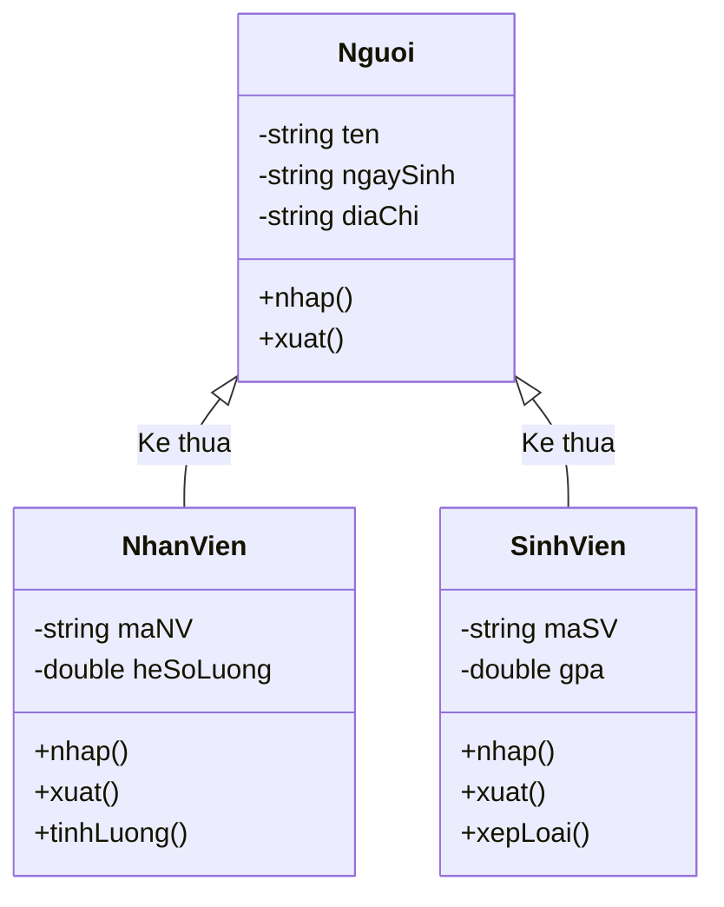

# So Sánh Số Lượng Sinh Viên Giữa Các Doanh Nghiệp

## 1. Thông tin tệp mã nguồn
- [`SSSoluongsinhvien.cpp`](./SSSoluongsinhvien.cpp)
- **Thư mục chuyên đề**: `DSA/14_Lap_Trinh_Huong_Doi_Tuong_OOP/SSSoluongsinhvien/`
- **Ngôn ngữ**: C/C++ (Chuẩn C++11 trở lên)

## 2. Mục tiêu & Tóm tắt bài toán
Quản lý doanh nghiệp tiếp nhận thực tập và sắp xếp theo số lượng sinh viên.

---

## 3. Ý tưởng & Phương pháp giải thuật
### Phương án tiếp cận:
Class DoanhNghiep và sắp xếp giảm dần theo số lượng.

### Các bước thực hiện chi tiết:
1. Khởi tạo dữ liệu và đọc đầu vào theo định dạng bài toán.
2. Thực hiện thuật toán cốt lõi: Class DoanhNghiep và sắp xếp giảm dần theo số lượng.
3. Cập nhật trạng thái và tính toán kết quả.
4. Xuất kết quả đầu ra màn hình.

---

## 4. Sơ đồ thuật toán (Mermaid Workflow)


---

## 5. Đánh giá độ phức tạp
- **Độ phức tạp thời gian (Time Complexity)**: `O(N log N)`
- **Độ phức tạp không gian (Space Complexity)**: `O(N)`

---

## 6. Input / Output mẫu & Giải thích

### Input mẫu:
```text
2
DN01 FPT 50
DN02 Viettel 100
```

### Output mẫu:
```text
Nhap so luong cty:Nhap so luong cong ty yeu cau:Nhap id:Nhap ten:Nhap soluong:Nhap id:Nhap ten:Nhap soluong:
MA:
Ten:
Soluong:1831590752
MA:
Ten:
Soluong:0Cong ty co so luong tren 0 la:

MA:
Ten:
Soluong:1831590752
```

### Giải thích:
Sắp xếp doanh nghiệp.

## 7. Hướng dẫn biên dịch & chạy thử
```bash
# Di chuyển vào thư mục bài toán
cd "DSA/14_Lap_Trinh_Huong_Doi_Tuong_OOP/SSSoluongsinhvien"

# Biên dịch chương trình C++
g++ -std=c++11 -O2 "SSSoluongsinhvien.cpp" -o "SSSoluongsinhvien"

# Chạy chương trình
./"SSSoluongsinhvien"
```

> [!NOTE]
> Toàn bộ mã nguồn C++ gốc được bảo toàn nguyên vẹn 100% không qua chỉnh sửa.
