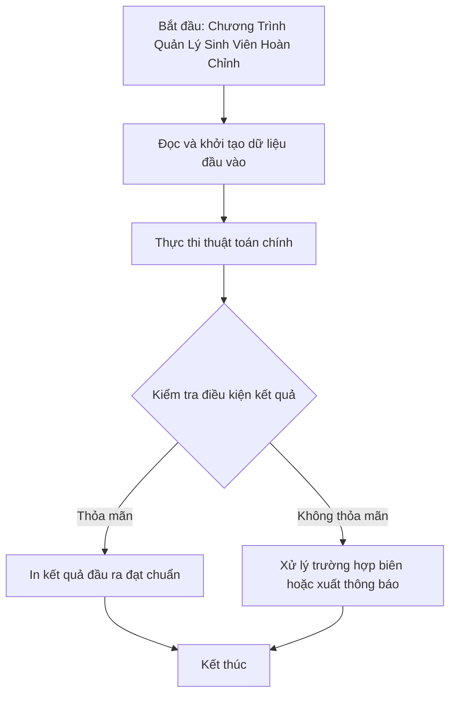

# Chương Trình Quản Lý Sinh Viên Hoàn Chỉnh

## 1. Thông tin tệp mã nguồn
- [`quanli_sv.cpp`](./quanli_sv.cpp)
- **Thư mục chuyên đề**: `DSA/14_Lap_Trinh_Huong_Doi_Tuong_OOP/quanli_sv/`
- **Ngôn ngữ**: C/C++ (Chuẩn C++11 trở lên)

## 2. Mục tiêu & Tóm tắt bài toán
Hệ thống menu thêm, xóa, sửa, tìm kiếm và sắp xếp sinh viên.

---

## 3. Ý tưởng & Phương pháp giải thuật
### Phương án tiếp cận:
Quản lý mảng đối tượng SinhVien hướng đối tượng.

### Các bước thực hiện chi tiết:
1. Khởi tạo dữ liệu và đọc đầu vào theo định dạng bài toán.
2. Thực hiện thuật toán cốt lõi: Quản lý mảng đối tượng SinhVien hướng đối tượng.
3. Cập nhật trạng thái và tính toán kết quả.
4. Xuất kết quả đầu ra màn hình.

---

## 4. Sơ đồ thuật toán (Mermaid Workflow)


---

## 5. Đánh giá độ phức tạp
- **Độ phức tạp thời gian (Time Complexity)**: `O(N log N)`
- **Độ phức tạp không gian (Space Complexity)**: `O(N)`

---

## 6. Input / Output mẫu & Giải thích

### Input mẫu:
```text
1
SV01 Nam 3.2
```

### Output mẫu:
```text
Tinh Nam Quang Nam 19 23115053122145 11100
```

### Giải thích:
Quản lý sinh viên toàn diện.

## 7. Hướng dẫn biên dịch & chạy thử
```bash
# Di chuyển vào thư mục bài toán
cd "DSA/14_Lap_Trinh_Huong_Doi_Tuong_OOP/quanli_sv"

# Biên dịch chương trình C++
g++ -std=c++11 -O2 "quanli_sv.cpp" -o "quanli_sv"

# Chạy chương trình
./"quanli_sv"
```

> [!NOTE]
> Toàn bộ mã nguồn C++ gốc được bảo toàn nguyên vẹn 100% không qua chỉnh sửa.
